# KubeView

> **A next-generation Kubernetes desktop IDE and operations platform.**  
> Built to surpass legacy Kubernetes desktop tooling (Lens, Freelens, Octant) with instant startup, rock-solid cluster connectivity, high-density observability, interactive topology visualization, and guardrailed operations.

---

## 🌟 Vision & Philosophy

**KubeView** is engineered around a core principle: **build a dependable Kubernetes desktop IDE first, then evolve it into a comprehensive operations and intelligence platform.**

Most Kubernetes GUI clients suffer from high memory overhead (Electron eating 1GB+ RAM), sluggish webview performance on large clusters (10,000+ pods), fragile connection management with modern cloud credential plugins, and confusing UX for day-to-day triage. KubeView directly solves these bottlenecks:

1. **Dependable Foundations First**: Before adding bells and whistles, cluster connectivity, multi-kubeconfig handling, authentications (AWS IAM, Azure kubelogin, GCP, OIDC), and safe resource operations must be bulletproof.
2. **Official Kubernetes Reliability (`client-go`)**: The backend engine runs native Go with official `client-go`, providing 100% fidelity with the Kubernetes ecosystem and dynamic CRD discovery.
3. **Troubleshooting Over Mere Browsing**: Finding what is failing takes one click. Rather than digging through 5 separate pages, a unified triage workbench correlates logs, events, exit codes, scheduling conditions, and container probes.
4. **Safety & Guardrails**: Destructive actions are guarded by explicit server-side dry-run diffs, validation, RBAC capability checks, and clear confirmation prompts.
5. **Speed & Scalability**: Zero lag on large enterprise clusters using virtualized data grids, efficient informers/watches, and native background streaming.

---

## 🏗️ Production-Ready Tech Stack

KubeView uses a **three-tier decoupled architecture** designed for separation of concerns and independent versioning:

```
┌────────────────────────────────────────────────────────────────────────┐
│  Tier 1: Presentation (Next.js Static Export + React + TypeScript)      │
│  • shadcn/ui + Tailwind CSS 4 + Motion + Sonner + cmdk                 │
│  • Zustand (Client State) + TanStack Query (Server State)              │
│  • TanStack Table (Data Grid) + Apache ECharts (Metrics Visualization) │
│  • Monaco Editor & Monaco Diff Editor (YAML & Semantic Diffs)          │
│  • Geist Font Family (Crisp developer typography)                      │
└───────────────────────────────────┬────────────────────────────────────┘
                                    │ Tauri IPC / Events
┌───────────────────────────────────▼────────────────────────────────────┐
│  Tier 2: Desktop Host Shell (Tauri 2 / Rust)                           │
│  • Lightweight Native Host (<80MB RAM vs 800MB in Electron)            │
│  • Window management, system tray, and host-enforced security sandbox  │
│  • Process supervisor for the Go engine sidecar                        │
└───────────────────────────────────┬────────────────────────────────────┘
                                    │ Versioned JSON-RPC over Local IPC
┌───────────────────────────────────▼────────────────────────────────────┐
│  Tier 3: Kubernetes Engine (Go + client-go Sidecar)                    │
│  • Official k8s.io/client-go (Typed Clients, Dynamic CRD Client)       │
│  • clientcmd (Kubeconfig parsing, multi-path merge & file watching)    │
│  • SharedInformerFactory (DeltaFIFO caching & debounced updates)       │
│  • High-throughput log streaming & PTY container exec terminal         │
│  • Structured diagnostic logging via Go log/slog                       │
└────────────────────────────────────────────────────────────────────────┘
```

| Layer | Technologies |
| :--- | :--- |
| **Desktop Host** | Tauri 2 (Rust) |
| **Web UI** | Next.js (Static Export `output: 'export'`) + React 19 + TypeScript |
| **Design System** | shadcn/ui + Tailwind CSS 4 + Motion + Lucide React + Geist |
| **State & Data** | Zustand (Client) + TanStack Query (Server Cache) + TanStack Table |
| **YAML & Diff** | Monaco Editor + Monaco Diff Editor |
| **Data Viz** | Apache ECharts |
| **Kubernetes Engine** | Go 1.23+ + official `client-go` + `clientcmd` + `log/slog` |
| **Tooling & Tests** | `pnpm` + Lefthook + Vitest + Testing Library + Playwright + Go `testify` + `envtest` |

---

## 🎨 Visual Design System & Design Tokens

KubeView is built dark-first with a high-density, accessible layout:

- **Background:** `#17191D`
- **Surface:** `#22252B`
- **Accent:** `#F08A42`
- **Status Healthy:** `#38B879`
- **Status Warning:** `#F5A623`
- **Status Critical:** `#E05252`

---

## 🗺️ Roadmap & Milestones

KubeView's development is structured into **16 focused phases** across three milestone releases:

```mermaid
flowchart LR
    subgraph Milestone1 ["Milestone 1: Core Desktop IDE (v0.1 - v0.5)"]
        P1["01. Desktop Shell"] --> P2["02. Cluster Connectivity"]
        P2 --> P3["03. Cluster Dashboard"]
        P3 --> P4["04. Resource Browser"]
        P4 --> P5["05. Resource Ops & YAML"]
        P5 --> P6["06. Troubleshooting Workbench"]
    end

    subgraph Milestone2 ["Milestone 2: Deep Observability & Ops (v0.6 - v0.9)"]
        P6 --> P7["07. Workload Topology"]
        P7 --> P8["08. Metrics & Monitoring"]
        P8 --> P9["09. Networking & Cilium"]
        P9 --> P10["10. Storage & Longhorn"]
        P10 --> P11["11. Helm Management"]
    end

    subgraph Milestone3 ["Milestone 3: Extensibility & AI (v1.0 Production)"]
        P11 --> P12["12. Security & RBAC Guard"]
        P12 --> P13["13. Plugin & Extension SDK"]
        P13 --> P14["14. Advanced Productivity"]
        P14 --> P15["15. AI-Assisted Operations"]
        P15 --> P16["16. Hardening & Distribution"]
    end
```



---

## 📚 Project Documentation

The documentation is organized in the [`docs/`](file:///Users/alexkgm/KubeView/docs) directory:

- 📋 [**ROADMAP.md**](file:///Users/alexkgm/KubeView/ROADMAP.md) — Complete 16-phase roadmap, detailed checklists, and progress tracker.
- 🛠️ [**docs/TECH_STACK.md**](file:///Users/alexkgm/KubeView/docs/TECH_STACK.md) — Complete production-ready tech stack reference and library roles.
- 🏛️ [**docs/ARCHITECTURE.md**](file:///Users/alexkgm/KubeView/docs/ARCHITECTURE.md) — Three-tier architecture, Go engine sidecar, IPC protocol, Monaco integration, and security model.
- 🚀 [**docs/EXECUTION_PLAN.md**](file:///Users/alexkgm/KubeView/docs/EXECUTION_PLAN.md) — Step-by-step implementation plan, task breakdown, dependencies, milestones, and risk mitigations.
- 📖 [**docs/phases/**](file:///Users/alexkgm/KubeView/docs/phases) — Phase-by-phase functional and technical specifications:
  - [Phase 1: Core Desktop Application](file:///Users/alexkgm/KubeView/docs/phases/phase-01-core-desktop.md)
  - [Phase 2: Kubernetes Connection Management](file:///Users/alexkgm/KubeView/docs/phases/phase-02-connectivity.md)
  - [Phase 3: Cluster Overview & Dashboard](file:///Users/alexkgm/KubeView/docs/phases/phase-03-cluster-dashboard.md)
  - [Phase 4: Complete Kubernetes Resource Browser](file:///Users/alexkgm/KubeView/docs/phases/phase-04-resource-browser.md)
  - [Phase 5: Resource Operations & YAML Editor](file:///Users/alexkgm/KubeView/docs/phases/phase-05-resource-operations.md)
  - [Phase 6: Pod & Container Troubleshooting Workbench](file:///Users/alexkgm/KubeView/docs/phases/phase-06-troubleshooting.md)

---

## ⚖️ KubeView vs Other Kubernetes Tools

| Capability | Freelens / Lens | k9s | Headlamp | **KubeView** |
| :--- | :--- | :--- | :--- | :--- |
| **Form Factor** | Desktop GUI (Electron) | Terminal TUI | Web / Electron | **Desktop IDE (Tauri 2 + Go Sidecar)** |
| **Memory Footprint** | ~600MB – 1.2GB | ~30MB | ~300MB | **~60MB – 90MB** |
| **K8s Engine** | Node.js client | Go client-go | Go backend | **Official Go `client-go` Sidecar** |
| **YAML Editing** | Basic Monaco | Text editor | Monaco | **Monaco + Server Dry-Run Diffs** |
| **Troubleshooting** | Fragmented across tabs | Fast, split views | Basic views | **Unified 1-click triage (Logs+Events+Probes+Exec)** |
| **Data Viz** | Basic SVG | Text gauges | Basic charts | **Apache ECharts (realtime & historical)** |
| **Destructive Safety**| Basic prompt | Fast keybinds | Basic prompt | **Server-side Dry-Run Diff + RBAC check** |
| **Extensibility** | Closed/Proprietary | None | Plugins | **Sandboxed TypeScript Plugin SDK** |
