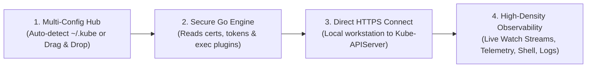

<p align="center">
  
</p>

# KubeView

<p align="center">
  <a href="LICENSE"></a>
  <a href="SECURITY.md"></a>
  <a href="CONTRIBUTING.md"></a>
  <a href="CODE_OF_CONDUCT.md"></a>
  <a href="https://go.dev"></a>
  <a href="https://tauri.app"></a>
  <a href="https://nextjs.org"></a>
</p>

> **A next-generation Kubernetes desktop IDE and operations platform.**  
> Built to surpass legacy Kubernetes desktop tooling (Lens, Freelens, Octant) with instant startup, rock-solid cluster connectivity, high-density observability, interactive topology visualization, and guardrailed operations.

---

## 🌟 Vision & Guiding Principle

**KubeView** is engineered around a local-first, layered desktop architecture:

- **100% Agentless & Local-First:** You provide your Kubernetes `kubeconfig`, and KubeView connects to your cluster directly. **Zero in-cluster agents, zero operators, zero cloud accounts, zero remote backends.**
- **The Frontend (Next.js Static Export + React 19 + Tailwind CSS 4):** High-performance client-side rendering with zero-latency tab switching and telemetry visualization. Credentials never enter the UI.
- **The Native Host (Tauri 2 + Rust):** Ultra-lightweight native host (<80MB RAM), manages process sandboxing, window framing, and supervises the Go engine sidecar.
- **The Kubernetes Engine (Go Sidecar + client-go):** Executes all Kubernetes API operations, real-time watch streams, informers, and credential resolution. Communicates exclusively over versioned JSON-RPC 2.0 via standard I/O pipes (`stdin`/`stdout`).
- **The Kubernetes API Server:** The authoritative gatekeeper for cluster state and RBAC authorization.

---

## 🚀 How KubeView Works



1. **Multi-Source Kubeconfig Onboarding:** Automatically indexes standard OS paths (`~/.kube/config`, `~/.kube/kubeconfig`, `$KUBECONFIG`), accepts folder/file drag & drop with multi-file selection, or raw YAML input.
2. **Secure Authentication:** The Go engine resolves authentication credentials, client certificates, and external auth plugins (`aws-iam-authenticator`, `gke-gcloud-auth-plugin`, etc.). Tokens remain in Go memory and are never exposed to the frontend.
3. **Direct HTTPS / TLS API Connection:** Connects directly from the workstation to the Kubernetes API server with internal Docker/KinD bridge IP override support.
4. **Real-Time Cluster Operations:** Provides live telemetry dashboards, resource data grids, streaming logs, interactive terminal exec, and full YAML inspection.

---

## ✨ Implemented Core Features

### 1. 📊 Cluster Overview & Live Telemetry Matrix

- **Bento Metric Cards:** Live CPU core allocation (used vs. allocatable capacity), memory byte allocation, healthy/ready node ratio, and active cluster workload counts.
- **Interactive SVG Telemetry Charts:** CPU & Memory allocation trends and capacity thresholds rendered natively with sub-millisecond precision.
- **Node Matrix Grid:** Visual node cards with real-time condition beacons (`Ready`, `DiskPressure`, `MemoryPressure`), capacity percentages, and one-click node inspection.
- **Click-to-Filter Workload Routing:** Clicking any node in the matrix immediately routes to the Pods view with an active node filter applied.
- **Workload Controllers Breakdown:** Aggregated health counts for Deployments, StatefulSets, DaemonSets, Jobs, and CronJobs.
- **Cluster Warning Events Ticker:** Real-time Kubernetes warning event stream with categorized warning pills.
- **Dynamic Namespace Scoping:** Changing the active namespace instantly recalculates the entire overview metrics and node allocations for that specific namespace, with a one-click return to cluster-wide view.

### 2. ⚡ Pods Management & Data Grid

- **Real-Time Watch Streaming:** Integrated Kubernetes Informer and Watch API stream for zero-polling real-time updates.
- **High-Speed Client-Side Filtering:** Instant search by pod name, namespace, node, or IP address. Status filter pills for `All`, `Running`, `Pending`, and `Failing`.
- **Multi-Column Sorting:** Sort by name, namespace, status, restart count, or age.
- **Batch Workload Actions:** Multi-select pods with floating batch action bar for bulk pod restarts and deletion.
- **Empty & Offline States:** Informative state cards with suggestions, commands, and one-click namespace switching.

### 3. 🔍 Deep Resource Inspector Drawer

- **Node Inspector:** Full node metadata, architecture, OS image, container runtime, kubelet version, internal/external IPs, condition history, allocated pods list, and expandable system labels & annotations.
- **Pod Inspector:** Real-time container state chips, container image hashes, port mappings, restart counters, environment variable viewer with copy & search, readiness/liveness probes, and volume mounts.
- **Conditions & Events Tabs:** Historical timeline of resource conditions and real Kubernetes warning/normal events.
- **Live YAML Tab:** Formatted YAML viewer with one-click clipboard copy and syntax highlighting.
- **Direct Action Triggers:** One-click shortcuts for logs, exec terminal, restart, and delete.

### 4. 💻 Troubleshooting Workbench (Logs & Shell Exec)

- **Interactive Container Terminal:** Built-in terminal emulator for interactive `sh`/`bash` exec into running containers.
- **High-Throughput Streaming Logs:** Real-time log viewer with line search, auto-scroll toggle, full log download, and container dropdown switcher.

### 5. 🌐 Kubeconfig & Cluster Management Hub

- **OS Auto-Detection:** Automatically scans and indexes contexts from `~/.kube/config`, `~/.kube/kubeconfig`, and environment paths.
- **Batch File & Folder Scanner:** Drag & drop folders containing multiple kubeconfigs with automatic parsing and multi-context discovery.
- **Internal Host Endpoint Config:** Detects internal hostnames (e.g., KinD/Minikube internal addresses) and allows instant master IP override without touching host files.
- **Cluster Switcher & Diagnostics:** Switch between cluster contexts instantly, with automated 4-stage connection diagnostics (Network, Auth, TLS/API, RBAC).

### 6. 🔀 GitOps Drift

- **Local Manifest Sources:** Scan a local Git worktree or manifest directory containing raw Kubernetes YAML.
- **Native Source Picking:** Choose or drag in a folder from the desktop app, auto-scan it, and reopen recent sources quickly.
- **Drift Classification:** Compare desired manifests against live resources and classify each as in sync, changed, missing, or error.
- **Focused Diff Review:** Inspect desired and live YAML side by side using the shared diff renderer.
- **Reviewed Apply:** Validate the desired manifest with a dry-run, check RBAC capabilities, then apply only after explicit confirmation.
- **Local-First Safety:** Manifest contents are read by the Go sidecar and never uploaded. Helm release/chart browsing is read-only; remote Git, Kustomize, Helm lifecycle actions, Argo CD, Flux, and CI integrations remain planned.

### 7. 🧭 Cluster Rail & Catalog

- **Far-left cluster rail** with live health dots, two-letter context tags, pinning, and quick switching.
- **Catalog sidebar** with clusters, kubeconfigs, web links, learning, and fleet health.
- **Catalog tools** include search, environment labels, pins, bulk actions, sorting, latency, and a detail drawer.

### 8. 🧩 Complete Resource Coverage

- All **36 reference resource pages** now exist, including namespaces, events, replication controllers, endpoint slices, ingress classes, PVCs, HPAs, PDBs, quotas, limits, scheduling classes, leases, and admission resources.
- Shared search, sorting, filtering, detail drawer, YAML copy, and guarded deletes across the simple-resource pages.

### 9. ⛵ Helm Browser

- **Helm releases** decoded from cluster release secrets, with chart, app version, revision, and status.
- **Chart repositories** can be added locally and browsed read-only. Helm install/upgrade/rollback remain future work.

### 10. ⚙️ Settings V2

- Startup page, cluster rail visibility, sidebar launch behavior, guardrails, read-only context protection, density, accent/status/accessibility palettes, polling behavior, notifications, terminal/log defaults, Helm integrations, and settings export/import.

---

## 🏛️ Enterprise Modular Architecture

Every major view and component in KubeView adheres to clean architecture principles:

- **Maximum File Length Under 500 Lines:** All legacy monolithic views have been decomposed into cohesive subcomponents with explicit TypeScript contracts.
- **100% Backward Compatibility:** Re-export barrels preserve standard import paths across the codebase.
- **WCAG AA Compliance:** High-contrast tokens, semantic ARIA attributes, and full keyboard navigation support across dropdowns, tables, drawers, and modal dialogs.

```
apps/desktop/src/
├── app/                              # Next.js App Router (Layout, Not-Found, Error Boundaries)
├── components/
│   ├── command/                      # Global Command Palette (cmdk)
│   ├── layout/                       # AppShell, AppHeader, AppSidebar, TabBar, ContextSwitcher
│   ├── modals/                       # PodLogsModal, PodExecModal, InteractiveTerminal, EndpointEditModal
│   ├── onboarding/kubeconfig/        # Modular Kubeconfig Hub (AutoDetect, BrowseFiles, PasteYaml, Manage)
│   ├── ui/                           # Design System Primitives (BentoGrid, StatusBeacon, Badges, Skeletons)
│   └── views/
│       ├── overview/                 # Modular Cluster Overview (BentoMetricCards, NodeMatrix, Charts)
│       ├── inspector/                # Modular Resource Inspector (Node, Pod, Containers, Conditions, YAML)
│       └── resources/                # Modular Resource Browser (Toolbar, TableRow, BatchToolbar, Banners)
├── stores/                           # Zustand Stores (clusterStore, tabStore) & clusterTypes
└── lib/                              # IPC Engine Bridge, RPC Invokers, Endpoint Helpers
```

---

## 📋 Requirements & Dependencies

| Requirement                      |  Needed?  | Notes                                                                      |
| :------------------------------- | :-------: | :------------------------------------------------------------------------- |
| **Kubernetes Cluster**           |  **Yes**  | Local (KinD, Minikube, k3s) or Cloud (EKS, GKE, AKS, bare-metal).          |
| **Valid Kubeconfig**             |  **Yes**  | Standard `~/.kube/config`, custom files, folders, or pasted YAML.          |
| **Network Path to API Server**   |  **Yes**  | Direct LAN, VPN, or proxy route to the Kubernetes API endpoint.            |
| **`kubectl` CLI Installed**      |  **No**   | Handled natively by Go `client-go`.                                        |
| **In-Cluster Agent or Operator** | ❌ **No** | **Strictly Agentless.** Zero workloads or CRDs injected into your cluster. |
| **KubeView Cloud Account**       | ❌ **No** | **100% Local-First.** No account creation, signup, or telemetry.           |
| **Remote Backend Service**       | ❌ **No** | Runs entirely on your local machine via bundled Go sidecar.                |

---

## 🛠️ Development & Testing

### Prerequisites

- **Node.js** >= 20.x
- **pnpm** >= 9.x
- **Go** >= 1.23
- **Rust & Cargo** (for Tauri native desktop build)

### Quick Start

```bash
# 1. Install dependencies
pnpm install

# 2. Start full development environment (Go Engine + Next.js App)
./dev.sh

# Or start the desktop frontend individually
pnpm --filter @kubeview/desktop dev
```

### Build & Verification

```bash
# Production Next.js build
pnpm --filter @kubeview/desktop run build

# Run Go engine tests and compilation
cd engine && go build ./...

# Check Rust Tauri host
cargo check --manifest-path src-tauri/Cargo.toml

# Run End-to-End Test Suite (Playwright)
cd apps/desktop && npx playwright test
```

---

## 🎨 Design Tokens

KubeView uses a dark-first, precision palette designed for sustained operational focus:

- **Background:** `#17191D`
- **Surface:** `#22252B`
- **Hover:** `#2C3038`
- **Subtle Borders:** `#323741`
- **Brand Accent:** `#F08A42` (Warm Kubernetes Amber)
- **Status Healthy:** `#38B879`
- **Status Warning:** `#F5A623`
- **Status Critical:** `#E05252`

---

## 📚 Project Documentation

Explore the detailed architecture and technical specifications in [`docs/`](docs/):

- 📖 [**docs/README.md**](docs/README.md) — Documentation index & navigation guide.
- 🏛️ [**docs/ARCHITECTURE.md**](docs/ARCHITECTURE.md) — Production architecture blueprint, IPC specification, and Go package layout.
- 🔒 [**docs/SECURITY_ARCHITECTURE.md**](docs/SECURITY_ARCHITECTURE.md) — Trust boundaries, credential isolation, and threat mitigations.
- 🚀 [**docs/FIRST_RUN_EXPERIENCE.md**](docs/FIRST_RUN_EXPERIENCE.md) — Zero-touch onboarding flow and 4-stage diagnostic probes.
- 📜 [**docs/contracts/IPC_SPECIFICATION.md**](docs/contracts/IPC_SPECIFICATION.md) — Versioned JSON-RPC 2.0 protocol specifications.
- 📋 [**ROADMAP.md**](ROADMAP.md) — Roadmap checklist, milestones, and implementation progress.

---

## 🏛️ Enterprise Governance & Security

KubeView is built for enterprise production readiness, adhering to open-source governance and security standards:

- 🔒 [**Security Policy (SECURITY.md)**](SECURITY.md) — Vulnerability reporting, Coordinated Disclosure SLA, trust model, and scope.
- 📜 [**License (LICENSE)**](LICENSE) — Open source under the **Apache License 2.0**. Use, modify, and distribute it under the license terms.
- 🤝 [**Contributing Guide (CONTRIBUTING.md)**](CONTRIBUTING.md) — Local development, conventional commits, quality gates, and PR review process.
- 💖 [**Code of Conduct (CODE_OF_CONDUCT.md)**](CODE_OF_CONDUCT.md) — Contributor Covenant v2.1 community pledge and enforcement standards.
- 📋 [**Changelog (CHANGELOG.md)**](CHANGELOG.md) — Keep a Changelog version history and release notes.

---

## 📄 License & Community Usage

KubeView is open source under the **Apache License 2.0**.

- **Open Source:** You may use, reproduce, modify, and distribute KubeView, including commercially, under the terms of the Apache License 2.0.
- **Patent Grant:** The license includes an express patent grant from contributors.
- **Attribution:** Keep the copyright notice and NOTICE file with distributions.

See the [LICENSE](LICENSE) file for the full legal text.

Copyright © 2026 [Seng Porkeat](https://github.com/PorKeat).
