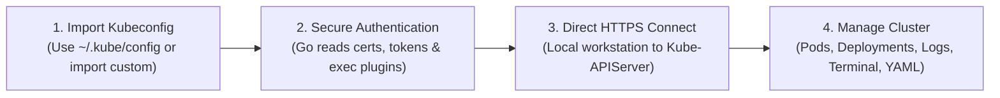

  

# KubeView

> **A next-generation Kubernetes desktop IDE and operations platform.**  
> Built to surpass legacy Kubernetes desktop tooling (Lens, Freelens, Octant) with instant startup, rock-solid cluster connectivity, high-density observability, interactive topology visualization, and guardrailed operations.

---

## 🌟 Vision & Guiding Principle

**KubeView** is engineered around a local-first, layered desktop architecture:

- **100% Agentless & Local-First:** You provide your Kubernetes `kubeconfig`, and KubeView connects to your cluster directly. **Zero in-cluster agents, zero operators, zero cloud accounts, zero remote backends.**
- **The Frontend (Next.js Static Export + React)** displays and requests operations. It must *never* own cluster credentials or execute unrestricted shell commands.
- **The Native Host (Tauri 2 + Rust)** controls process access, enforces capabilities/permissions, and supervises the Go engine. It must *never* duplicate Kubernetes business logic.
- **The Kubernetes Engine (Go Sidecar + client-go)** performs all Kubernetes API operations, watch streams, and credential resolution. It must *never* execute arbitrary frontend-controlled shell commands.
- **The Kubernetes API Server** is the authoritative gatekeeper for cluster state and RBAC authorization.

---

## 🚀 How KubeView Works

1. **Import Kubeconfig:** Select your existing config file or use the auto-detected `~/.kube/config`.
2. **Authenticate Securely:** Go reads the context, credentials, certificates, and authentication configuration. Tokens stay in memory and are never exposed to the UI.
3. **Connect to Kubernetes:** Connect directly to the API server using HTTPS/TLS and the configured credentials.
4. **Manage Your Cluster:** View Pods, Deployments, logs, events, nodes, YAML, and other resources allowed by your RBAC permissions.

---

## 📋 What Users Need vs What Is NOT Needed

| Requirement | Needed? | Notes |
| :--- | :---: | :--- |
| **Kubernetes Cluster** | **Yes** | Local (KinD, Minikube, k3s) or Cloud (EKS, GKE, AKS, bare-metal). |
| **Valid Kubeconfig** | **Yes** | Standard `~/.kube/config`, custom paths, or `$KUBECONFIG`. |
| **Network Access to API Server** | **Yes** | Direct LAN, VPN, or proxy path to the Kubernetes API endpoint. |
| **Valid Credentials / Plugin** | **Yes** | Client certs, bearer tokens, or external auth plugins (AWS, Azure, GCP). |
| **`kubectl` CLI Installed** | **No** | Go `client-go` handles all API communication natively. |
| **In-Cluster Agent or Operator** | ❌ **No** | **Strictly Agentless.** Zero workloads or CRDs injected into your cluster. |
| **KubeView Cloud Account** | ❌ **No** | **100% Local-First.** No account creation, signup, or telemetry lock-in. |
| **Remote KubeView Backend** | ❌ **No** | The backend runs locally on your machine as a bundled Go sidecar. |

---

## 🔒 Security Architecture Highlights

1. **Zero Credential Exposure:** Tokens, client certificates, private keys, and exec-helper secrets exist **only in Go engine memory**. They are NEVER passed to the React UI, plugins, telemetry, or logs.
2. **No Local Network Sockets:** The Go engine communicates exclusively via **inherited stdio pipes (`stdin`/`stdout`)** using newline-delimited JSON-RPC 2.0. No local TCP/HTTP ports are opened.
3. **Controlled Credential Execution:** External `exec` credential plugins require explicit user approval, execute directly (no shell), and run with sanitized environments and 10s timeouts.
4. **Server-Side Apply & Dry-Run Diff:** All declarative changes use Kubernetes Server-Side Apply with field manager `kubeview`. Local YAML is validated and dry-run tested (`dryRun=All`) before live mutation.
5. **Secret Masking:** Sensitive values in Secrets and environment variables are masked by default (`••••••••`) across all views.
6. **Host-Enforced Permissions:** Plugins and external integrations are constrained by host capabilities and cannot bypass security checks.

---

## 🎨 Visual Design System & Design Tokens

KubeView is built dark-first with a high-density, accessible layout:

- **Background:** `#17191D`
- **Surface:** `#22252B`
- **Hover:** `#2C3038`
- **Subtle Borders:** `#323741`
- **Accent / Brand:** `#F08A42`
- **Status Healthy:** `#38B879`
- **Status Warning:** `#F5A623`
- **Status Critical:** `#E05252`

---

## 🚀 9-Step Implementation Sequence

1. **01. Architecture Foundation:** Monorepo (`pnpm`), contracts package, Tauri 2 host shell, and Next.js static export (`output: "export"`).
2. **02. Engine Lifecycle & Supervision:** Bundled Go sidecar, protocol handshake, stdio IPC dispatcher, and crash recovery.
3. **03. Cluster Access & Connectivity:** Kubeconfig via `clientcmd`, context switching, auth plugins, and 4-stage diagnostics.
4. **04. Resource Browser & Data Grid:** API discovery, dynamic CRDs via `client-go/dynamic`, TanStack Table v8.
5. **05. Resource Operations & Monaco YAML:** Monaco Editor, server-side dry-run diffs, safe apply, deletion guardrails.
6. **06. Troubleshooting Workbench:** High-throughput live logs, `xterm.js` PTY container exec, 1-click root cause triage.
7. **07. Performance, Caching & Safety:** `SharedInformerFactory`, DeltaFIFO, concurrency limits, secret redaction.
8. **08. Integrations & Sandboxed Plugins:** Capability-based plugin SDK, Helm, Cilium, Longhorn, ArgoCD adapters.
9. **09. Production Hardening & Release:** Multi-platform CI/CD, code signing, auto-update, KinD/envtest matrix.

---

## 📚 Project Documentation (`docs/`)

All project documentation is consolidated in the [`docs/`](file:///Users/alexkgm/KubeView/docs) directory:

- 📖 [**docs/README.md**](file:///Users/alexkgm/KubeView/docs/README.md) — Master documentation index and sitemap.
- 🔒 [**docs/SECURITY_ARCHITECTURE.md**](file:///Users/alexkgm/KubeView/docs/SECURITY_ARCHITECTURE.md) — Production Security Architecture (Process boundaries, kubeconfigs, exec plugins, secrets, RBAC, threat model, checklist).
- 🚀 [**docs/FIRST_RUN_EXPERIENCE.md**](file:///Users/alexkgm/KubeView/docs/FIRST_RUN_EXPERIENCE.md) — Agentless onboarding flow, 4-stage automated connection diagnostics, and user guidance.
- 🏛️ [**docs/ARCHITECTURE.md**](file:///Users/alexkgm/KubeView/docs/ARCHITECTURE.md) — Comprehensive Production Architecture Blueprint, supervisor state machine, and Go package architecture.
- 📜 [**docs/contracts/IPC_SPECIFICATION.md**](file:///Users/alexkgm/KubeView/docs/contracts/IPC_SPECIFICATION.md) — Versioned JSON-RPC 2.0 protocol contracts (`rpc/v1`), domain methods, envelopes, and error catalog.
- 🛠️ [**docs/TECH_STACK.md**](file:///Users/alexkgm/KubeView/docs/TECH_STACK.md) — Production tech stack reference and dependency specifications.
- 🚀 [**docs/EXECUTION_PLAN.md**](file:///Users/alexkgm/KubeView/docs/EXECUTION_PLAN.md) — 9-step implementation sequence, task breakdown, testing strategy, and risk mitigations.
- 📋 [**docs/ROADMAP.md**](file:///Users/alexkgm/KubeView/docs/ROADMAP.md) — 16-phase roadmap checklist and status tracking (0/16 completed).
- 📖 [**docs/phases/**](file:///Users/alexkgm/KubeView/docs/phases) — Specifications for Phases 1 through 6.
