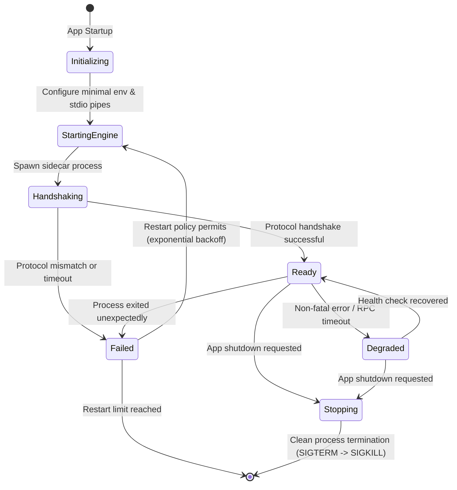
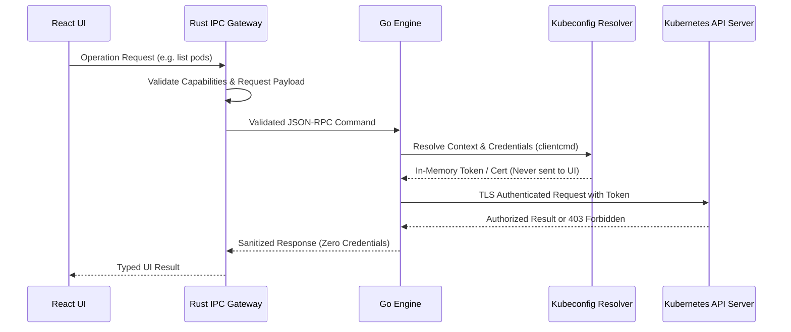
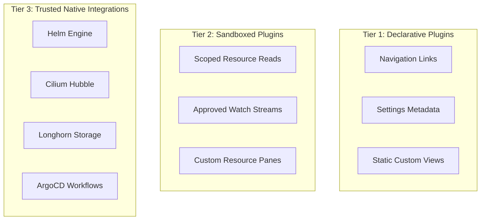

# KubeView — Production Architecture Blueprint

> **Architectural Principle:** Local-first, layered desktop architecture where the **React UI displays and requests operations**, the **native Tauri host controls process access and permissions**, and the **Go engine performs Kubernetes operations**. Kubernetes credentials are never exposed to the React UI or plugins.

---

## 1. Overall System Architecture

```mermaid
flowchart TD
    subgraph UI ["Layer 1: Frontend Presentation (Next.js Static Export / React / TypeScript)"]
        Components["UI Components (shadcn/ui + Tailwind CSS 4 + Motion)"]
        Stores["State Management (Zustand + TanStack Query)"]
        Services["Typed Frontend Services (contracts package)"]
    end

    subgraph Host ["Layer 2: Native Host & Security Boundary (Tauri 2 / Rust)"]
        CmdValidator["Command Validation & Origin Check"]
        PermEngine["Host-Enforced Permissions & Capabilities"]
        Supervisor["Go Engine Supervisor (Lifecycle, Backoff, Health)"]
        SecureStore["Secure Local Storage & OS Keychain"]
        IPCGateway["JSON-RPC 2.0 Pipe Dispatcher (stdin/stdout)"]
    end

    subgraph Engine ["Layer 3: Kubernetes Engine (Go Sidecar / client-go)"]
        ClusterMgr["Cluster Manager (clientcmd & kubeconfig)"]
        ResourceAPI["Resource CRUD & Server-Side Apply Engine"]
        WatchMgr["Watch Manager (SharedInformerFactory & DeltaFIFO)"]
        StreamEngine["Streaming Engine (Logs, Exec PTY, Port-Forward)"]
        Discovery["Discovery & CRD Introspection"]
        MetricsAdapters["Metrics Server & Prometheus Adapters"]
        ExtAdapters["Integrations (Helm, Longhorn, Cilium, ArgoCD)"]
    end

    subgraph Cluster ["Layer 4: Kubernetes Infrastructure"]
        APIServer["Kube-APIServer (REST, Watch, SPDY/WebSocket)"]
        ClusterRBAC["Authoritative RBAC Enforcement"]
    end

    UI <-->|Typed Tauri Commands & Events| Host
    Host <-->|Versioned JSON-RPC 2.0 (stdin/stdout pipes)| Engine
    Engine <-->|HTTPS REST, Watch, SPDY (TLS Authenticated)| APIServer
    APIServer --> ClusterRBAC
```

---

## 2. Responsibilities by Layer

| Layer | Owns | Must NOT Own |
| :--- | :--- | :--- |
| **Next.js / React** | UI presentation, navigation, forms, local view state, table interactions, editor rendering. | Cluster credentials, direct filesystem access, unrestricted shell execution. |
| **Tauri / Rust** | IPC gateway, process lifecycle, supervisor, permission enforcement, native OS integration, secure key storage. | Kubernetes business logic duplicated from Go, direct Kubernetes API calls. |
| **Go Engine** | Kubernetes clients, resource operations, informers/watches, log/PTY streams, API discovery, credential resolver. | Arbitrary frontend-controlled command execution, desktop windowing state. |
| **Kubernetes API** | Authoritative cluster state, server-side admission, and RBAC authorization. | Desktop UI state. |

---

## 3. Desktop Framework & Next.js Static Export

KubeView uses **Next.js with `output: 'export'`** as a zero-runtime static web bundle hosted inside **Tauri 2**:

- **No Node Server in Production:** The desktop application contains zero Next.js runtime server, eliminating server action vulnerabilities and Node process memory overhead.
- **Frontend Stack:** Next.js App Router, React 19, strict TypeScript, Tailwind CSS 4, shadcn/ui, TanStack Query, Zustand, Monaco Editor & Monaco Diff Editor.
- **Frontend Data Flow:**
  1. User navigates to a resource page (e.g. Pods).
  2. React calls a typed service method from `@kubeview/contracts`.
  3. The service invokes an allowlisted Tauri IPC command.
  4. Rust validates the request against host capabilities and forwards the JSON-RPC payload to the Go engine's `stdin`.
  5. Go executes the operation via `client-go` against the target cluster.
  6. Go writes the JSON-RPC response to `stdout`.
  7. Rust returns the typed response to React.
  8. TanStack Query caches the result and updates the UI.

---

## 4. Process Management: Rust Supervises Go

The Go engine is packaged as a **bundled Tauri sidecar executable** (`kubeview-engine`). Rust is the sole owner of the engine lifecycle.

### Engine Lifecycle State Machine



### Lifecycle Rules
1. **Startup Handshake:** Upon spawning the Go process, Rust and Go perform an immediate `engine.handshake` verifying protocol compatibility (`protocolVersion: "1.0.0"`).
2. **Standard I/O Isolation:** Engine diagnostic logs are strictly emitted to `stderr` (using `log/slog`), keeping `stdout` 100% clean for JSON-RPC message framing.
3. **Crash Recovery:** If the Go engine exits unexpectedly, Rust restarts it with exponential backoff up to a hard limit (e.g., max 3 restarts in 60s). If the limit is reached, the UI displays a fatal engine alert.
4. **Graceful Shutdown:** On app quit, Rust sends an `engine.shutdown` notification, waits up to 3 seconds for active watches, log streams, and port-forward tunnels to close, and falls back to `SIGKILL` only if unresponsive.

---

## 5. IPC Transport & JSON-RPC Protocol

KubeView uses **JSON-RPC 2.0 over standard I/O pipes (stdin/stdout)** with newline-delimited JSON (`\n`) framing.

- **No Open TCP Ports:** Eliminates all attack surfaces from other local processes on the user's workstation.
- **Strict Framing & Limits:** Enforces a maximum message size (16MB) and bounded internal queues.
- **Zero Generic Execution:** There is NO generic `execute(command)` IPC method. All operations are explicitly named and validated.

### JSON-RPC Message Wire Format

```json
// Request
{
  "jsonrpc": "2.0",
  "id": "req-1042",
  "method": "resources.list",
  "params": {
    "clusterId": "cluster-01",
    "apiVersion": "v1",
    "resource": "pods",
    "namespace": "default",
    "limit": 100
  }
}

// Success Response
{
  "jsonrpc": "2.0",
  "id": "req-1042",
  "result": {
    "items": [],
    "continueToken": null,
    "resourceVersion": "123456"
  }
}

// Error Response (Redacted, structured)
{
  "jsonrpc": "2.0",
  "id": "req-1042",
  "error": {
    "code": "K8S_FORBIDDEN",
    "message": "You do not have permission to list Pods in this namespace.",
    "retryable": false,
    "details": {
      "resource": "pods",
      "namespace": "default",
      "operation": "list"
    }
  }
}
```

### Streaming Contract (Logs, Watches, Exec)
Long-running operations use explicit subscription lifecycles rather than blocking requests:
- `watch.start` / `watch.stop` (Resource delta events)
- `logs.start` / `logs.stop` (Chunked log stream)
- `exec.start` / `exec.input` / `exec.resize` / `exec.stop` (Interactive PTY session)
- `portForward.start` / `portForward.stop` (Network tunnel)

```typescript
export interface StreamEvent<T> {
  streamId: string;
  sequence: number;
  type: "data" | "error" | "closed";
  data?: T;
  error?: {
    code: string;
    message: string;
  };
}
```

---

## 6. Security Architecture & Credential Isolation



### Core Security Rules
1. **Zero Credential Exposure:** Tokens, client certificates, private keys, and exec-helper secrets exist **only in Go engine memory**. They are NEVER passed to the React UI, plugins, telemetry, or logs.
2. **Server-Side Apply & Safe Mutations:** Declarative changes use Kubernetes Server-Side Apply with field manager `kubeview`. Local YAML is validated and dry-run tested (`dryRun=All`) before mutation.
3. **Secret Redaction:** `v1/Secret` data is masked (`********`) by default across all views and cannot be exposed through logs or IPC errors.
4. **RBAC Pre-Flight Checks:** Queries `SelfSubjectAccessReview` before showing destructive actions, but treats the cluster's API server as the authoritative gatekeeper.

---

## 7. Plugin Trust & Isolation Model

Plugins are categorized into three explicit trust tiers:



- **Manifest Declaration:** Every plugin must provide a signed `plugin.json` declaring its required capabilities, permissions, and supported resource kinds.
- **Host Enforcement:** Permissions are enforced at the Rust host boundary; plugins are never granted raw shell, filesystem, or credential access.
- **Initial Milestone:** The core plugin SDK will be released with trusted built-in integrations; untrusted third-party plugin execution is deferred until full worker isolation is verified.

---

## 8. Go Engine Modular Monolith Architecture

The Go engine is structured as an internal modular monolith in `engine/`:

```
engine/
├── cmd/
│   └── kubeview-engine/
│       └── main.go                  # Main entrypoint: flag parsing, stdio setup, signal handling
├── internal/
│   ├── app/
│   │   ├── bootstrap.go             # Subsystem initialization & handshake
│   │   └── shutdown.go              # Coordinated graceful shutdown
│   ├── ipc/
│   │   ├── transport.go             # stdin/stdout reader/writer with line framing
│   │   ├── dispatcher.go            # Method routing and concurrency limits
│   │   ├── protocol.go              # JSON-RPC 2.0 schemas
│   │   └── errors.go                # Standardized error codes & redactor
│   ├── cluster/
│   │   ├── manager.go               # Active cluster connection pool
│   │   ├── kubeconfig.go            # clientcmd loader & fsnotify watcher
│   │   └── credentials.go           # In-memory credential caching & exec plugins
│   ├── kubernetes/
│   │   ├── clients.go               # typed clientset & dynamic client factory
│   │   ├── discovery.go             # API group & resource discovery
│   │   ├── resources.go             # Generic resource CRUD & pagination
│   │   ├── apply.go                 # Server-Side Apply & dry-run diff engine
│   │   └── authorization.go         # SelfSubjectAccessReview checks
│   ├── watch/
│   │   ├── manager.go               # SharedInformerFactory coordinator
│   │   └── subscription.go          # Filtered watch event dispatching
│   ├── streaming/
│   │   ├── logs.go                  # Pod log streamer with tail & since
│   │   ├── exec.go                  # Interactive SPDY/WebSocket PTY terminal
│   │   └── portforward.go           # TCP port forwarding manager
│   ├── metrics/
│   │   ├── current.go               # Metrics Server consumer
│   │   └── prometheus.go            # PromQL query client
│   ├── integrations/
│   │   ├── helm/                    # Helm driver adapter
│   │   ├── longhorn/                # Longhorn CRD client
│   │   ├── cilium/                  # Cilium network client
│   │   └── argocd/                  # ArgoCD application client
│   └── observability/
│       └── logger.go                # slog structured logging to stderr
├── pkg/
│   └── contracts/                   # Shared types (mirrored with TS package)
└── tests/
    ├── e2e/                         # Engine integration tests
    └── mocks/                       # Fake clientsets and envtest fixtures
```

---

## 9. Monorepo Repository Structure

```
KubeView/
├── apps/
│   └── desktop/                     # Next.js Static Export (React 19 + TypeScript)
│       ├── app/                     # App Router pages
│       ├── components/              # UI components & design system
│       ├── features/                # Domain features (clusters, workloads, triage)
│       ├── services/                # Typed frontend IPC client
│       ├── stores/                  # Zustand stores
│       ├── lib/                     # Utilities
│       ├── next.config.ts           # output: "export"
│       └── package.json
├── src-tauri/                       # Native Desktop Host (Tauri 2 / Rust)
│   ├── src/
│   │   ├── commands/                # Allowlisted Tauri IPC commands
│   │   ├── ipc/                     # JSON-RPC bridge over stdio
│   │   ├── supervisor/              # Go engine sidecar process supervisor
│   │   ├── security/                # Host permission checks & capability validator
│   │   └── main.rs                  # Tauri entrypoint
│   ├── capabilities/                # Tauri 2 capability definitions
│   ├── binaries/                    # Target sidecar binaries for packaging
│   └── tauri.conf.json              # Tauri windowing & sidecar config
├── engine/                          # Kubernetes Engine (Go 1.23+ Sidecar)
│   ├── cmd/                         # Entrypoint
│   ├── internal/                    # Core subsystems
│   ├── go.mod
│   └── go.sum
├── packages/
│   ├── contracts/                   # Single source of truth for IPC types
│   ├── ui/                          # Shared UI primitives (shadcn/ui base)
│   └── plugin-sdk/                  # Extension development SDK
├── plugins/                         # First-party plugins (Longhorn, Cilium, ArgoCD)
├── docs/                            # Architectural & technical specs
│   ├── ARCHITECTURE.md              # This document
│   ├── TECH_STACK.md                # Ratified tech stack reference
│   ├── EXECUTION_PLAN.md            # Phased implementation plan
│   ├── ROADMAP.md                   # 16-phase roadmap checklist
│   ├── contracts/                   # IPC protocol contract specifications
│   │   └── IPC_SPECIFICATION.md
│   └── phases/                      # Phase specifications (Phases 1-6)
├── scripts/                         # Build, sidecar compilation & packaging scripts
├── .github/workflows/               # Multi-platform CI/CD (macOS, Windows, Linux)
├── pnpm-workspace.yaml              # pnpm monorepo workspace definition
└── lefthook.yml                     # Git hooks for linting, formatting & testing
```
