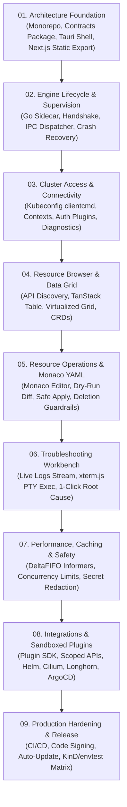

# KubeView Implementation & Execution Plan

> **Plan Objective:** A structured 9-step engineering execution plan to build KubeView according to the **Production Architecture Blueprint**: Next.js static export UI + Tauri 2 Rust supervisor + Go `client-go` sidecar with versioned JSON-RPC over stdio.

---

## 1. Architectural Implementation Sequence

---

## 2. Step-by-Step Implementation Breakdown

---

### Step 01: Architecture Foundation

**Scope:** Monorepo scaffolding, versioned contracts package, Tauri 2 host shell, and Next.js static export.

- [ ] **Monorepo Setup:**
  - Configure `pnpm-workspace.yaml` with `apps/desktop`, `packages/contracts`, and `src-tauri`.
  - Configure `Lefthook` with ESLint v9, Prettier, and TypeScript strict checks.
- [ ] **Versioned Contracts Package (`packages/contracts`):**
  - Define TypeScript interfaces and Go structs for all JSON-RPC 2.0 messages, envelopes, and error codes.
  - Export typed definitions for `ResourceRef`, `ListResourcesRequest`, `ResourceList<T>`, `StreamEvent<T>`.
- [ ] **Next.js Static Export Application (`apps/desktop`):**
  - Setup Next.js 15+ App Router with `output: "export"`.
  - Configure Tailwind CSS 4, shadcn/ui components, Geist Sans & Geist Mono fonts, and `next-themes`.
  - Implement design system tokens: `#17191D` bg, `#22252B` surface, `#F08A42` accent, `#38B879` healthy.
  - Implement basic layout: frameless titlebar, collapsible sidebar, tabbed workspace, and status bar.
- [ ] **Tauri 2 Host Configuration (`src-tauri`):**
  - Setup Tauri 2 with macOS traffic lights and native window controls.
  - Setup `tauri-plugin-store` for client settings persistence.

---

### Step 02: Engine Lifecycle & Process Supervision

**Scope:** Go sidecar packaging, protocol handshake, stdio IPC dispatcher, and crash recovery.

- [ ] **Go Engine Scaffolding (`engine/`):**
  - Initialize Go 1.23+ module with standard directory layout: `cmd/kubeview-engine/`, `internal/app/`, `internal/ipc/`.
  - Configure Go `log/slog` to write strictly to `stderr`.
- [ ] **Stdio IPC Transport & Framing:**
  - Implement newline-delimited JSON (`\n`) reader/writer on `stdin`/`stdout`.
  - Enforce 16 MB maximum message payload limit.
- [ ] **Protocol Handshake & Negotiation:**
  - Implement `engine.handshake` verifying `protocolVersion: "1.0.0"`.
  - Rust supervisor enforces handshake before routing any client requests.
- [ ] **Rust Process Supervisor:**
  - Tauri supervisor spawns `kubeview-engine` binary.
  - Monitor process exit codes; handle unexpected EOF.
  - Implement exponential backoff restart policy (max 3 restarts within 60 seconds).
  - Implement clean graceful shutdown sequence on app exit.

---

### Step 03: Cluster Access & Connectivity

**Scope:** Kubeconfig loading via `clientcmd`, context switching, auth plugins, and connection diagnostics.

- [ ] **Kubeconfig Resolver (`internal/cluster`):**
  - Ingest `$KUBECONFIG` paths and standard `~/.kube/config` using official `k8s.io/client-go/tools/clientcmd`.
  - Implement `contexts.list` and `clusters.get` RPC methods.
  - Implement `fsnotify` file watcher for silent auto-reload on external kubeconfig edits.
- [ ] **Cloud Credential Helper Integration:**
  - Support `aws eks get-token`, `aws-iam-authenticator`, Azure `kubelogin`, GCP `gke-gcloud-auth-plugin`.
  - In-memory credential caching based on expiration timestamps (never exposed to UI).
- [ ] **Connection Probes & Diagnostics:**
  - Probe cluster endpoint (`/readyz`, `/livez`, API version).
  - Diagnostic error generator mapping network failures and TLS timeouts to human-readable hints.

---

### Step 04: Resource Browser & Virtualized Grid

**Scope:** API discovery, dynamic CRD client, TanStack Table v8, and virtualized data grid.

- [ ] **Kubernetes API Discovery (`internal/kubernetes`):**
  - Implement `discovery.apiGroups` and `discovery.resources` using `client-go/discovery`.
  - Cache discovered API resources and supported verbs.
- [ ] **Dynamic & Typed Resource Handlers:**
  - Typed `client-go` clients for Pods, Nodes, Deployments, Services, ConfigMaps, PV/PVC.
  - `client-go/dynamic` client for Custom Resource Definitions.
  - Introspect `additionalPrinterColumns` to dynamically configure CRD table headers.
- [ ] **Virtualized Table Grid (Next.js):**
  - TanStack Table v8 with compact row heights (32px) and virtualization.
  - Multi-column sorting, fuzzy search, and column layout persistence in local storage.
  - Color-coded status badges (`#38B879` healthy, `#F5A623` warning, `#E05252` critical).

---

### Step 05: Resource Operations & Monaco YAML Editor

**Scope:** Monaco YAML editor, Monaco Diff Editor, server-side dry-run diffs, and safe mutations.

- [ ] **Monaco YAML Editor & Schema Validation:**
  - Embed Monaco Editor with Kubernetes JSONSchema auto-completion matching cluster version.
  - React Hook Form + Zod for structured parameter editing.
- [ ] **Server-Side Dry-Run & Monaco Diff Editor:**
  - Implement `resources.diff` executing `PATCH/POST` with `dryRun=All` via Go engine.
  - Monaco Diff Editor side-by-side visual diff modal comparing live state against proposed manifest.
  - Clear visual warnings for immutable fields requiring resource recreation.
- [ ] **Workload Lifecycle Operations:**
  - Implement scale slider, zero-downtime rolling restart, and revision rollback.
  - Safe deletion modal with typed confirmation for production namespaces.
  - Background `SelfSubjectAccessReview` pre-flight checks.

---

### Step 06: Troubleshooting Workbench

**Scope:** High-throughput live logs, xterm.js container exec, probe diagnostics, and 1-click triage.

- [ ] **Live Log Streamer (`internal/streaming`):**
  - Stream container logs via Go engine to Rust host over IPC stream.
  - Support multi-container merged streams, tail lines, and previous terminated logs (`previous: true`).
  - Regex search, filter, autoscroll toggle, and download.
- [ ] **Container Exec PTY Terminal (`xterm.js`):**
  - SPDY/WebSocket PTY multiplexing in Go engine with terminal resize (`SIGWINCH`) support.
  - Interactive terminal in UI with ANSI colors and copy/paste shortcuts.
- [ ] **One-Click Triage & Root Cause Correlator:**
  - Synthesize failure state: exit code (Exit 137 OOMKilled), events, probes, and restart count.
  - Plain-English diagnostic breakdown explaining `CrashLoopBackOff`, `ImagePullBackOff`, and `Pending`.
  - 1-click export of troubleshooting bundles.

---

### Step 07: Performance, Caching & Safety

**Scope:** SharedInformerFactory, DeltaFIFO, concurrency limits, and secret redaction.

- [ ] **SharedInformerFactory & DeltaFIFO (`internal/watch`):**
  - Maintain in-memory resource cache in Go; emit debounced delta events to UI.
- [ ] **Concurrency Limits & Backpressure:**
  - Bounded channel buffers for log and watch streams to prevent UI freezing.
  - Drop or throttle stream messages when consumers cannot keep up.
- [ ] **Comprehensive Secret Redaction:**
  - Redact tokens, certs, and `v1/Secret` data from logs and error payloads.

---

### Step 08: Integrations & Sandboxed Plugins

**Scope:** Capability-based plugin SDK, scoped APIs, and first-party integration adapters.

- [ ] **Plugin SDK (`packages/plugin-sdk`):**
  - Define `plugin.json` manifest schema and TypeScript extension interfaces.
  - Host-enforced permission model restricting raw filesystem and credential access.
- [ ] **First-Party Integrations:**
  - Helm release lifecycle adapter.
  - Longhorn storage health adapter.
  - Cilium Hubble network flow adapter.
  - ArgoCD application status adapter.

---

### Step 09: Release Hardening & Distribution

**Scope:** Multi-platform CI/CD, code signing, automated updates, and integration tests.

- [ ] **Automated Testing Suite:**
  - Unit tests: Vitest (Frontend) and Go `testing` + `testify` (Engine).
  - Integration tests: Go `envtest` (real etcd + API server) and KinD clusters.
  - End-to-end tests: Playwright covering context switching, YAML diff, and log streaming.
- [ ] **Packaging & Code Signing:**
  - GitHub Actions CI matrix building for macOS (Universal), Windows (x64), and Linux.
  - Apple Developer ID notarization and Windows code signing.
  - Tauri updater configuration for seamless updates.
