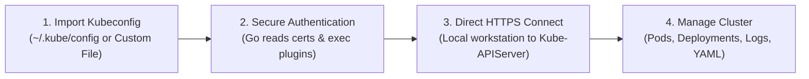
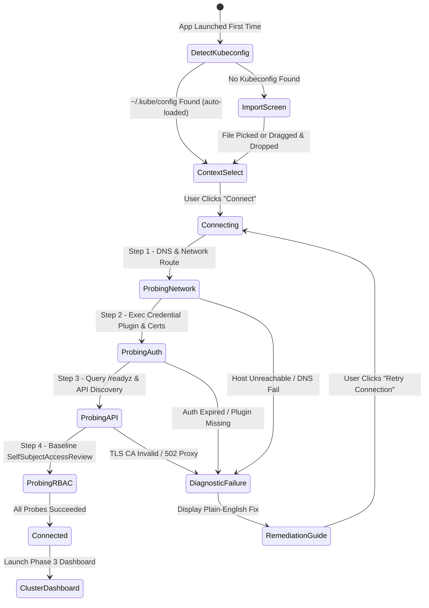

# KubeView — First-Run Experience & Connection Diagnostics

> **Design Objective:** The first-run experience must be as simple as **importing a kubeconfig, selecting a context, and clicking Connect**. KubeView requires **no in-cluster agents, no cloud accounts, and no remote backends**. If connectivity fails, it automatically diagnoses network, credential, and permission issues with actionable plain-language fixes.

---

## 1. How KubeView Works: 100% Agentless & Local-First



### What Users Need vs What Is NOT Needed

| Requirement                      |  Needed?  | Notes                                                                      |
| :------------------------------- | :-------: | :------------------------------------------------------------------------- |
| **Kubernetes Cluster**           |  **Yes**  | Local (KinD, Minikube, k3s) or Cloud (EKS, GKE, AKS, bare-metal).          |
| **Valid Kubeconfig**             |  **Yes**  | Standard `~/.kube/config`, custom paths, or `$KUBECONFIG`.                 |
| **Network Access to API Server** |  **Yes**  | Direct LAN, VPN, or proxy path to the Kubernetes API endpoint.             |
| **Valid Credentials / Plugin**   |  **Yes**  | Client certs, bearer tokens, or external auth plugins (AWS, Azure, GCP).   |
| **`kubectl` CLI Installed**      |  **No**   | Go `client-go` handles all API communication natively.                     |
| **In-Cluster Agent or Operator** | ❌ **No** | **Strictly Agentless.** Zero workloads or CRDs injected into your cluster. |
| **KubeView Cloud Account**       | ❌ **No** | **100% Local-First.** No account creation, signup, or telemetry lock-in.   |
| **Remote KubeView Backend**      | ❌ **No** | The backend runs locally on your machine as a bundled Go sidecar.          |

---

## 2. The First-Run Onboarding Flow



### Screen 1: Welcome & Kubeconfig Discovery

- **Auto-Detection:** Automatically inspects `$KUBECONFIG` and `~/.kube/config`. If valid contexts exist, populates a clean context cards grid immediately.
- **Manual Import Option:** If no default config is found, presents an elegant drag-and-drop zone:
  - Drag and drop `.kube/config` or `.yaml` file.
  - "Browse Files" button.
  - "Paste Kubeconfig Text" modal.

### Screen 2: Context Selection & Connection Preview

Displays discovered cluster contexts in a compact card grid:

- Cluster name and alias.
- Control plane server URL (e.g. `https://192.168.1.100:6443` or `*.eks.amazonaws.com`).
- Configured user identity & auth type (Client Cert, Token, or Exec Plugin).
- Default namespace.
- Primary **"Connect"** button (Accent color `#F08A42`).

---

## 3. Automated Connection Diagnostics Pipeline

When the user clicks **Connect**, the Go engine executes a 4-stage sequential diagnostic probe:

### Stage 1: Network & DNS Probe

- **Check:** Resolves the API server hostname and establishes a raw TCP handshake.
- **Failure Symptoms:** DNS resolution failure, network timeout (no route to host), firewall block.
- **Diagnostic Output:**
  ```
  ❌ Cannot reach Kubernetes API server at "api.internal.company.com:6443"
  💡 Recommendation:
  • Verify that your corporate VPN or WireGuard tunnel is active.
  • Check if your workstation is on the required subnet.
  ```

### Stage 2: Authentication & Credential Plugin Probe

- **Check:** Validates client certificates expiration date; for exec plugins (e.g. `aws eks get-token`, `kubelogin`), executes the plugin binary with a 10s timeout.
- **Failure Symptoms:** Missing CLI binary in `$PATH`, expired SSO token, invalid credentials.
- **Diagnostic Output:**
  ```
  ❌ Authentication Failed: "aws eks get-token" exited with status 1
  💡 Recommendation:
  • Your AWS SSO session has expired. Run `aws sso login` in your terminal to refresh credentials.
  • Ensure the `aws` CLI binary is installed and accessible in your system PATH.
  ```

### Stage 3: TLS & API Health Probe

- **Check:** Initiates HTTPS TLS handshake with CA certificate verification; queries `/readyz` or `/livez`.
- **Failure Symptoms:** `x509: certificate signed by unknown authority`, self-signed cert rejected.
- **Diagnostic Output:**
  ```
  ❌ TLS Verification Failed: Certificate signed by unknown authority
  💡 Recommendation:
  • Your cluster appears to use a private or self-signed CA certificate.
  • Verify that `certificate-authority-data` is properly set in your kubeconfig.
  • If this is a local development cluster (KinD/Minikube), check if `insecure-skip-tls-verify: true` is desired.
  ```

### Stage 4: RBAC Baseline Verification

- **Check:** Queries `SelfSubjectAccessReview` for basic discovery (`get namespaces`, `list pods`).
- **Failure Symptoms:** Authenticated as user `dev-user`, but user has no RBAC permissions.
- **Diagnostic Output:**
  ```
  ⚠️ Connected with Restricted Permissions
  Authenticated as: system:serviceaccount:default:dev-user
  • You have permission to view workloads in namespace: "default"
  • You do NOT have cluster-wide permissions (Listing all namespaces is denied).
  • KubeView will automatically scope your view to the "default" namespace.
  ```

---

## 4. Important Real-World Limitations & User Guidance

KubeView transparently informs users of inherent Kubernetes operational boundaries:

1. **Private API Endpoints:** If a cluster has a private endpoint (common in EKS/GKE with private endpoint enabled), the user's computer must have access through a VPN, direct connect, or bastion tunnel.
2. **External Executable Dependencies:** If a kubeconfig uses `exec: apiVersion: client.authentication.k8s.io/v1`, the corresponding CLI tool (`aws`, `kubelogin`, `gcloud`) must be present on the host system. KubeView surfaces missing tools with download links.
3. **True RBAC Parity:** KubeView cannot bypass Kubernetes RBAC. If a user cannot delete a pod via `kubectl`, KubeView will not permit it either. Action buttons are disabled before the user even clicks them.
4. **Cluster-Specific Add-Ons:** Metrics graphs, Helm management, Longhorn storage, and Cilium flows require their respective controllers to be present in the cluster. KubeView gracefully degrades when an add-on is missing without throwing application errors.
