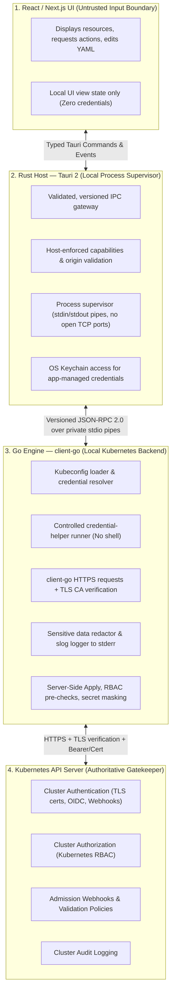
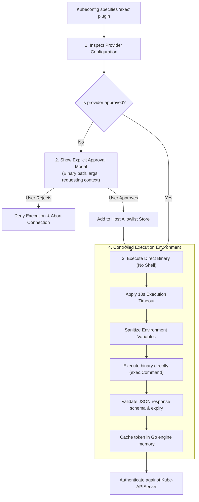

# KubeView: Production Security Architecture

> **Core Security Principle:** The desktop application may display Kubernetes data, but credentials and privileged operations must remain strictly under tightly controlled host-side services. Security spans all three process boundaries: **React/Next.js UI**, **Tauri/Rust Host**, and the **Go `client-go` Engine**.

---

## 1. Security Boundaries & Trust Model

### Trust Boundary Rules
1. **The UI is NOT a security authority.** All inputs from the Next.js UI are treated as untrusted.
2. **Dual Validation:** Rust validates the local IPC process boundary and capabilities; Go independently re-validates method names, arguments, resource identifiers, and namespaces at the domain boundary.
3. **Authoritative Cluster Security:** Kubernetes RBAC and admission controllers remain the ultimate authority for cluster mutations. KubeView's local pre-flight checks (`SelfSubjectAccessReview`) improve user experience but never replace server-side enforcement.

---

## 2. Kubeconfig Management & Embedded Credentials

Kubeconfig is sensitive configuration that can contain credentials capable of cluster control.

### Required Handling Behaviors
- **Default File Support:** Load `~/.kube/config` when present, and allow users to import custom files.
- **Multi-File Precedence:** Ingest `$KUBECONFIG` paths preserving documented Kubernetes merge semantics. Explicitly display the active context and configuration source in the UI.
- **Read-Only by Default:** Imported kubeconfigs are strictly read-only. KubeView never modifies or rewrites a user's original kubeconfig when changing active contexts.
- **Native File Picker:** Always use a native OS file dialog for kubeconfig imports. Never accept arbitrary raw filesystem paths from the UI.
- **No Path Traversal:** Resolve and validate all file paths within the native Rust host to prevent path traversal attacks.
- **Safe Diagnostics:** Never print raw kubeconfig contents, client certificates, private keys, bearer tokens, or credential-plugin output into logs or diagnostic support bundles.

### Handling Embedded Credentials

| Credential Type | Production Behavior |
| :--- | :--- |
| **External kubeconfig file** | Read directly from configured path; do not copy automatically into app storage. |
| **Bearer token** | Kept strictly in Go engine memory; **never exposed to React or plugins**. |
| **Client certificate / key** | Used exclusively for TLS authentication; **never export or log private keys**. |
| **`exec` credential configuration**| Governed by the strict External Command Policy (Section 3). |
| **Embedded CA certificate** | Used strictly to verify the API server's TLS certificate. |
| **`insecure-skip-tls-verify`** | **Rejected by default.** Requires a deliberate, clearly explained user override modal. Never enabled silently. |

> [!CAUTION]
> KubeView must never disable TLS certificate verification merely to make a connection succeed.

---

## 3. Credential Plugins & External Command Execution

Kubeconfigs frequently use `exec` credential providers (e.g. `aws eks get-token`, `kubelogin`, `gke-gcloud-auth-plugin`) to retrieve short-lived tokens. This represents a significant local security risk: a malicious kubeconfig could attempt to execute arbitrary programs with the user's OS privileges.

### Production Execution Policy

### Implementation Requirements
1. **No Shell Invocation:** Never launch plugins via `sh -c` or `cmd.exe`. Execute the resolved binary directly with validated, discrete arguments.
2. **Deterministic Binary Resolution:** Resolve executables deterministically, inspect file ownership and permissions, and protect against symlink replacement attacks.
3. **Explicit User Approval:** When an unapproved exec plugin is detected, show the provider name, binary path, arguments, and context, explaining that it executes with the user's OS privileges.
4. **Sanitized Environment:** Pass only the environment variables required by legitimate cloud authentication flows (e.g., `AWS_PROFILE`, `AZURE_CONFIG_DIR`, `PATH`). Do not leak host secrets.
5. **Bounded Execution:** Enforce strict timeouts (10 seconds), output size limits (1 MB), and automatic child-process cancellation on timeout or app exit.
6. **Zero Token Logging:** Never write exec plugin output, stdout, or stderr to disk logs.

---

## 4. Kubernetes Secrets & Sensitive Data Handling

Kubernetes Secrets (`v1/Secret`) are base64-encoded, not encrypted. Their values must be protected against accidental UI leaks, clipboard retention, and diagnostic exposure.

### Secret Handling Policy

| Area | Required Production Behavior |
| :--- | :--- |
| **Secret Discovery** | Fetch and render only metadata (`name`, `namespace`, `labels`, `annotations`, `type`, `age`). Do not request `.data` until necessary. |
| **Secret Details** | Values are masked (`••••••••`) by default. Require an explicit **"Reveal"** click before displaying plain text. |
| **Secret Editing** | Require deliberate confirmation before committing changes to live cluster state. |
| **Clipboard** | Copy sensitive values only upon explicit button click; warn the user and clear transient memory immediately. |
| **Logs & Events** | Automatically sanitize and redact tokens, keys, passwords, and sensitive fields using Go `log/slog` redactors. |
| **Crash Reports** | Never attach Secret objects, tokens, or raw authentication responses to crash reports or telemetry. |
| **Caching** | Never persist Secret values in `localStorage`, IndexedDB, or Zustand persistence stores. Clear transient values on tab close. |
| **Diagnostic Export** | Redact all Secret values by default when exporting troubleshooting bundles. |
| **YAML Editor** | Clearly badge Secret manifests with a "Sensitive Resource" indicator and mask data values where practical. |

> [!NOTE]
> A "Reveal" button is a UI safeguard to prevent shoulder-surfing, not an authorization control. Actual access is governed by the Kubernetes API server.

---

## 5. Kubernetes Permissions & RBAC Safety

KubeView operates strictly under the Kubernetes identity selected by the user. It **never requires `cluster-admin` privileges**, never silently impersonates other users, and never attempts unauthorized privilege escalation.

### Operational Modes
1. **Read-Only Mode (Selectable):**
   - Users can browse authorized resources, view logs, and inspect events.
   - All mutation UI elements (create, scale, restart, delete, apply) are disabled.
   - Recommended as the default onboarding mode for production clusters.
2. **Write Mode:**
   - Create, patch, update, and delete resources only when the Kubernetes identity has explicit RBAC permission.
   - Destructive operations require explicit confirmation modals (typing the resource name in production namespaces).
3. **Elevated-Risk Operations:**
   - Container exec, port forwarding, secret reveals, and RBAC changes require distinct, visible UI indicators and contextual audit logging.

### Advisory RBAC Pre-Checks (`SelfSubjectAccessReview`)
KubeView queries `SelfSubjectAccessReview` to provide an intelligent, permission-aware UX:
- Action buttons are disabled if the user lacks the required RBAC verb.
- **Handling Denials (`403 Forbidden`):** Treated as normal authorization outcomes, not application errors. The UI displays clear, actionable feedback:
  > *Cannot delete `deployment/api` in namespace `production`. The current Kubernetes identity is not authorized to perform this operation.*
- Guidance advises users on the exact minimal RBAC permission required, rather than recommending `cluster-admin`.

---

## 6. IPC & Local Desktop Security

The frontend has no direct access to kubeconfigs, credential vaults, the Go sidecar process, or unrestricted system commands.

### Host Security Controls
- **Private Stdio Transport:** The Go engine communicates exclusively through inherited `stdin`/`stdout` pipes managed by Tauri. No listening TCP/HTTP port is exposed on `localhost`.
- **Strict Protocol Validation:** All messages conform to JSON-RPC 2.0 with Zod and Go schema validation.
- **No Generic Execution:** There is NO generic `execute(command)` IPC method. All operations are strictly typed and allowlisted.
- **Content Security Policy (CSP):** A restrictive CSP prevents loading remote scripts, inline scripts, or unauthorized fonts.
- **Stream Cancellation & Backpressure:** Active log streams, watches, and terminal sessions have bounded queues and can be canceled instantly by the client.

---

## 7. Credential Storage, Caching & Lifecycle

1. **OS Secure Keychain:** If KubeView must persist app-managed credentials, it uses the operating system's secure credential facility (macOS Keychain, Windows Credential Manager, Linux Secret Service).
2. **Zero Plaintext Persistence:** Tokens and keys are **never stored** in `localStorage`, cookies, Zustand persistence, plain JSON config files, or debug logs.
3. **Session Teardown:** Switching contexts, disconnecting, or closing the application immediately wipes all in-memory tokens and closes active network tunnels.
4. **Token Expiry Respect:** Respects token expiration timestamps and relies on standard refresh mechanisms rather than assuming static token validity.

---

## 8. Threat Model & Required Mitigations

| Threat | Likelihood | Impact | Production Mitigation |
| :--- | :---: | :---: | :--- |
| **Malicious Kubeconfig** | Medium | Critical | Native file picker import, path validation, controlled exec-plugin approval, TLS verification enforced. |
| **Malicious Credential Plugin** | Medium | Critical | Explicit approval modal before first run, direct binary execution (no shell), bounded execution timeouts. |
| **Compromised Frontend / XSS** | Low | High | Strict CSP, no Node server, zero credentials exposed to React, strictly allowlisted Tauri commands. |
| **Unauthorized Cluster Mutation** | Medium | High | Authoritative Kubernetes RBAC enforcement, server-side dry-run diffs, typed delete confirmations, read-only mode. |
| **Accidental Secret Leakage** | High | High | Masked values by default, no Secret caching, zero-secret logging redactors, sanitized diagnostic exports. |
| **Local IPC Abuse** | Low | High | Private stdio pipes (no open ports), JSON-RPC 2.0 schema validation, 16MB payload limits. |
| **Malicious Plugin** | Medium | High | Capability-based SDK, process isolation, host-enforced permissions; untrusted third-party plugins deferred. |
| **Diagnostic Data Leakage** | Medium | Medium | Automated redaction of tokens and keys in Go `log/slog` to stderr; opt-in diagnostic bundles. |

---

## 9. Production Security Readiness Checklist

| # | Security Verification Item | Category | Status |
| :---: | :--- | :--- | :---: |
| **01** | Native OS file picker used for kubeconfig import; source file never overwritten | Kubeconfig | ⏳ Pending |
| **02** | Handles multi-file `$KUBECONFIG` merge semantics and expired contexts safely | Kubeconfig | ⏳ Pending |
| **03** | Enforces explicit user approval policy for external `exec` credential plugins | Authentication | ⏳ Pending |
| **04** | Verifies TLS certificates by default; rejects `insecure-skip-tls-verify` without warning | TLS / Network | ⏳ Pending |
| **05** | Tokens, client private keys, and passwords never logged or sent to React | Secret Hygiene | ⏳ Pending |
| **06** | Secret values masked by default (`••••••••`) and never cached in persistent stores | Secret Hygiene | ⏳ Pending |
| **07** | Read-only mode available and selectable during first-run onboarding | RBAC & Safety | ⏳ Pending |
| **08** | Typed confirmation required for destructive actions in production namespaces | RBAC & Safety | ⏳ Pending |
| **09** | Private stdio pipes used for IPC; zero listening TCP/HTTP ports on localhost | IPC Security | ⏳ Pending |
| **10** | Dual validation: inputs validated in Rust and independently in Go | IPC Security | ⏳ Pending |
| **11** | Tauri capabilities restricted to absolute minimum; no generic shell execution | Host Sandbox | ⏳ Pending |
| **12** | Stream backpressure, 16MB payload limits, and bounded queues enforced | Host Sandbox | ⏳ Pending |
| **13** | Integration tests for expired credentials, network timeouts, and TLS failures | Release Quality | ⏳ Pending |
| **14** | Integration tests for malicious kubeconfigs and credential-plugin timeout limits | Release Quality | ⏳ Pending |
| **15** | Automated secret redaction verified across logs, error messages, and exports | Release Quality | ⏳ Pending |
| **16** | Desktop application signed and notarized for macOS, Windows, and Linux | Distribution | ⏳ Pending |

---

## 10. First-Release Security Non-Negotiables

For KubeView v1, these eight defaults are mandatory:

1. **Local-First & Agentless:** No mandatory KubeView cloud account, telemetry tracking, or in-cluster agents.
2. **Existing Identity:** Connect strictly using the user's selected kubeconfig context and Kubernetes credentials.
3. **No Silent Exec Plugin Execution:** Review and control credential helpers before running commands.
4. **Read-Only by Default Option:** Provide a prominent read-only toggle during onboarding for safer exploration.
5. **Sensitive Data Stays Transient:** Never persist Secret values or auth tokens in frontend storage or logs.
6. **No Privilege Escalation:** Never require `cluster-admin` just to make the core application work.
7. **Secure Plugin Boundary:** Ship trusted built-in integrations first; defer third-party execution until sandboxing is verified.
8. **Automated Security Verification:** Pass all 16 items of the Security Readiness Checklist before production release.
