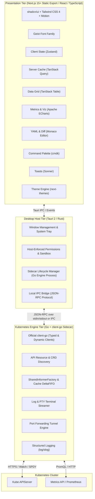

# KubeView — Complete Production-Ready Tech Stack

> **Design Objective:** A modern, actively maintained stack prioritizing high-density visual clarity, strong TypeScript end-to-end safety, native Go `client-go` Kubernetes compatibility, and rock-solid desktop performance with minimal resource overhead.

---

## 1. High-Level Technology Architecture

KubeView uses a **three-tier architecture** designed for separation of concerns and independent versioning:

---

## 2. Technology Selection Matrix

### 2.1 Frontend & UI

| Category | Library / Tool | Role in KubeView |
| :--- | :--- | :--- |
| **Desktop Framework** | **Tauri 2** | Lightweight cross-platform native host; provides secure IPC, system tray, window management, and native menus without Electron's memory overhead. |
| **Web Framework** | **Next.js + React + TypeScript** | Configured with `output: 'export'` for deterministic, lightning-fast static client bundle generation with full React 19 and App Router / page support. |
| **Styling** | **Tailwind CSS 4** | Ultra-fast CSS compilation, modern `@theme` directive, CSS variables for dynamic theme switching, zero runtime style cost. |
| **Component Library** | **shadcn/ui** | Accessible, headless primitives (Radix UI) styled for KubeView's high-density desktop aesthetic. |
| **Icons** | **Lucide React** | Cohesive, modern SVG iconography across cluster resource kinds, status badges, and actions. |
| **Animation** | **Motion** (Framer Motion) | Subtle layout transitions, slide-over drawers, and tabs (strictly limited in high-frequency dashboards to preserve CPU). |
| **Command Palette** | **cmdk** | Instant `Cmd+K` / `Ctrl+K` global command palette for resource jump, context switching, and actions. |
| **Notifications** | **Sonner** | Clean, non-intrusive toast notifications with action buttons and dismiss timers. |
| **Theme Engine** | **next-themes** | Flawless dark and light theme switching with zero flash of unstyled content (FOUC). |
| **Typography** | **Geist & Geist Mono** | Clean, highly legible monospace and sans typography engineered specifically for developer tools. |

### 2.2 Data, State, Forms & Visualization

| Category | Library / Tool | Role in KubeView |
| :--- | :--- | :--- |
| **Server State** | **TanStack Query (v5)** | Intelligent caching, background refetching, mutation lifecycle, and cache invalidation on cluster events. |
| **Client State** | **Zustand** | Lightweight client stores: active context, open tabs, drawer states, user preferences, column layout. |
| **Tables & Data Grid** | **TanStack Table (v8)** | Headless table logic: multi-column sorting, column reordering, resizing, filtering, and virtualized scrolling. |
| **Forms** | **React Hook Form** | High-performance, un-controlled form management for resource creation and configuration wizards. |
| **Validation** | **Zod** | End-to-end schema validation for forms, IPC message contracts, and plugin manifests. |
| **Data Visualization** | **Apache ECharts** | Canvas/SVG charting engine for real-time CPU/RAM meters, node pressure gauges, and historical Prometheus graphs. |
| **YAML Editor** | **Monaco Editor** | Full VS Code editor experience with Kubernetes JSONSchema autocompletion, syntax highlighting, and folding. |
| **Diff Viewer** | **Monaco Diff Editor** | Side-by-side and inline visual diffs comparing local manifests against live server-admitted resources. |
| **Date & Time** | **date-fns** | High-performance date math, relative timestamps (`3m ago`), and log time-range calculations. |

### 2.3 Kubernetes Engine & Native Integration

| Category | Technology | Role in KubeView |
| :--- | :--- | :--- |
| **Kubernetes Engine** | **Go (1.23+)** | Dedicated, high-performance background daemon/sidecar managing all cluster network I/O. |
| **Kubernetes Client** | **`client-go`** | The gold standard Kubernetes client: typed clientsets, informer factories, and connection resilience. |
| **Dynamic Resources** | **`client-go/dynamic`** | Dynamic client for CRDs and arbitrary custom resources without ahead-of-time code generation. |
| **Resource Discovery** | **`client-go/discovery`** | Dynamic API group discovery to adapt to any Kubernetes version (v1.26 - v1.34+). |
| **Native Host** | **Rust + Tauri 2** | Native desktop host, window management, process supervisor for the Go sidecar, and secure IPC bridge. |
| **IPC Communication** | **JSON-RPC 2.0 Protocol** | Typed, versioned JSON-RPC protocol over local IPC (stdin/stdout or local domain socket) between Host and Go Engine. |
| **Configuration** | **`clientcmd`** | Official kubeconfig parser supporting multi-file `$KUBECONFIG`, auth plugins, and context merging. |
| **Structured Logging** | **Go `log/slog`** | High-performance structured logging with log rotation and zero credential exposure. |
| **Metrics Integration** | **Metrics API + Prometheus** | Ingests real-time CPU/Memory metrics from Metrics Server and historical series via Prometheus PromQL. |

### 2.4 Plugin Architecture

| Category | Technology | Role in KubeView |
| :--- | :--- | :--- |
| **Plugin SDK** | **TypeScript** | Strongly-typed extension API exposing UI slots, custom resource inspectors, and command palette actions. |
| **Plugin Manifests** | **JSON Schema** | Standardized `plugin.json` declaring capabilities, required permissions, and extension points. |
| **Runtime Validation** | **Zod** | Validates plugin configuration, custom views, and messages at the boundary. |
| **UI Extension Points** | **React Components** | Custom tabs, dashboard widgets, and contextual resource actions. |
| **Process Isolation** | **Web Workers / Subprocesses** | Strictly isolates plugin execution; plugins never receive raw cluster credentials or direct filesystem access. |
| **Permission Model** | **Host-Enforced RBAC** | Host validates whether a plugin is granted network, cluster read, or action permissions before execution. |

### 2.5 Developer Experience, Quality & Tooling

| Category | Tool | Purpose |
| :--- | :--- | :--- |
| **Package Manager** | **`pnpm`** | Fast, disk-efficient package management with strict dependency resolution. |
| **Frontend Linting** | **ESLint (v9 Flat Config)** | Enforce modern TypeScript standards, React hooks rules, and import hygiene. |
| **Formatting** | **Prettier** | Opinionated code formatting across TypeScript, CSS, JSON, and YAML. |
| **Frontend Testing** | **Vitest** | Blazing-fast Vite-native unit test runner. |
| **Component Testing** | **Testing Library (React)** | User-centric UI component and interaction testing. |
| **End-to-End Testing** | **Playwright** | Full desktop workflow testing across macOS, Linux, and Windows. |
| **Go Testing** | **Go `testing` + `testify`** | Comprehensive unit and integration test suite for the Go Kubernetes engine. |
| **Mock Kubernetes API**| **`envtest` + fake clientsets** | Real etcd + kube-apiserver integration testing without spinning up full VM clusters. |
| **Git Hooks** | **Lefthook** | Ultra-fast Git pre-commit and pre-push hooks running linting, formatting, and type checks. |
| **CI/CD** | **GitHub Actions** | Automated multi-platform build matrix, testing, code signing, and release packaging. |

---

## 3. Visual Design System & Design Tokens

KubeView implements a dedicated developer design system built upon `shadcn/ui` and Tailwind CSS 4, optimized for **compact density, clear hierarchy, and immediate status recognition**.

### Design Tokens

| Token Name | Hex Value | Usage |
| :--- | :--- | :--- |
| **Background** | `#17191D` | Application main canvas, tab bar background, root shell. |
| **Surface** | `#22252B` | Cards, side-drawer panels, table rows, modal dialogs. |
| **Surface Hover** | `#2C3038` | Hover state for table rows, sidebar menu items, buttons. |
| **Surface Active** | `#343943` | Active tab, selected row, active sidebar item. |
| **Border / Subtle** | `#323741` | Subtle panel dividers, table column borders, card borders. |
| **Accent / Brand** | `#F08A42` | Primary buttons, active focus rings, cursor highlight, brand mark. |
| **Accent Muted** | `#F08A42` (15% opacity)| Active selection background, pill highlights. |
| **Status: Healthy** | `#38B879` | Running pods, ready nodes, healthy deployments, active endpoints. |
| **Status: Warning** | `#F5A623` | Pending pods, container restarting, approaching resource quota limits. |
| **Status: Critical** | `#E05252` | CrashLoopBackOff, OOMKilled, ImagePullBackOff, failed probes. |
| **Status: Muted** | `#8A919E` | Completed jobs, suspended cronjobs, inactive resources. |

### Core Design Principles

1. **Compact Density**: Kubernetes operators manage thousands of pods; tables must feature compact row heights (32px-36px), readable Geist typography, and horizontal efficiency.
2. **Subtle Borders over Glassmorphism**: Avoid blurry translucent glass effects that reduce contrast and cause GPU rendering lag during high log volume.
3. **Status Clarity**: Every workload status is immediately legible through standardized color-coded pills and text badges.
4. **Keyboard-First Navigation**: Resizable panels and full command palette integration ensure power users rarely need to leave the keyboard.
5. **No Visual Noise**: Avoid unnecessary animations in frequently updating dashboards; animations are strictly reserved for modal entrances and tab transitions.
