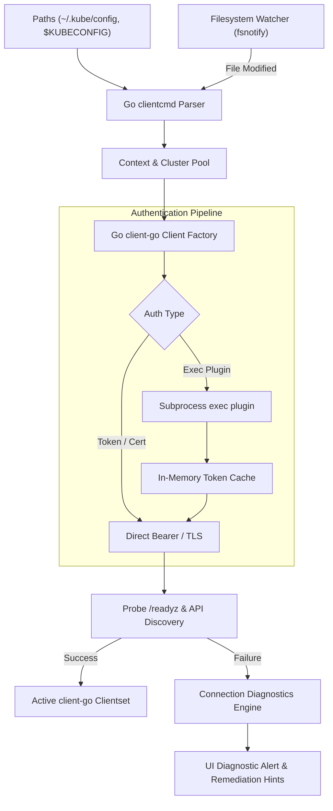

# Phase 2: Kubernetes Connection Management Specification

> **Phase Goal:** Deliver rock-solid, production-grade cluster connectivity. Run a dedicated **Go 1.23+ engine sidecar** with official **`k8s.io/client-go`** and **`clientcmd`**, communicating with the Tauri 2 host over versioned JSON-RPC.

---

## 1. Functional Scope

### 1.1 Kubeconfig Loading & Aggregation (Go `clientcmd`)
- Auto-detects standard kubeconfig locations via `k8s.io/client-go/tools/clientcmd`:
  - Custom file paths defined via `$KUBECONFIG` environment variable.
  - Standard user path: `~/.kube/config`.
  - Manual import of external kubeconfig files via drag-and-drop or file picker.
- Robust merging of multiple kubeconfig files following official `kubectl` precedence rules.
- Support for clusters with self-signed CA certificates, custom proxies, and client cert/key authentication.

### 1.2 Context & Namespace Management
- Instant context switcher in the app header displaying:
  - Cluster name and alias.
  - API server URL.
  - Active namespace.
  - Current connection status badge (Green = Connected, Yellow = Degraded/Slow, Red = Offline).
- Namespace switcher supporting:
  - Searchable list of all accessible namespaces.
  - "All Namespaces" aggregate mode.
  - Pinned/favorite namespaces for rapid switching.

### 1.3 Exec Credential Plugin Runner
Support modern cloud Kubernetes authentication without requiring manual token extraction:
- **AWS EKS:** `aws eks get-token` or `aws-iam-authenticator`.
- **Azure AKS:** `kubelogin` (Azure Active Directory / Entra ID).
- **Google Cloud GKE:** `gke-gcloud-auth-plugin`.
- **Custom OIDC Helpers:** Arbitrary exec plugins conforming to `client.authentication.k8s.io/v1`.
- Safe execution: Execute plugin binaries directly with sanitised arguments, preventing shell injection vulnerabilities.
- Token caching: Cache returned tokens according to their `expirationTimestamp` to prevent repeated subprocess spawning.

### 1.4 Dynamic Kubeconfig Watching & Hot Reload
- Utilize OS-level filesystem watchers (`fsnotify` in Go) to monitor loaded kubeconfig files.
- Automatically refresh cluster contexts when an external tool (e.g. `aws eks update-kubeconfig`, `kubectx`) alters the file.
- Silent reload: Avoid jarring UI resets or lost user view states during automatic reloads.

### 1.5 Structured Logging & Connection Diagnostics
- Structured diagnostic logging using Go's standard `log/slog` library.
- Zero plaintext credential logging: automatically redacts bearer tokens, client certificates, and private keys.
- Clear diagnostic feedback when connection fails:
  - Network unreachable vs DNS resolution failure.
  - Expired client certificates or OIDC tokens.
  - TLS certificate authority verification failures.
  - Actionable remediation tips (e.g., "Run `aws sso login` to refresh credentials").

---

## 2. Technical Implementation Architecture



### JSON-RPC Protocol Contract (`rpc/v1`)
```json
// Request: List Contexts
{
  "jsonrpc": "2.0",
  "id": 1,
  "method": "kube.listContexts",
  "params": {}
}

// Response: List Contexts
{
  "jsonrpc": "2.0",
  "id": 1,
  "result": {
    "contexts": [
      {
        "name": "arn:aws:eks:us-east-1:123456789012:cluster/prod",
        "cluster": "prod",
        "server": "https://ABCDEF123456.gr7.us-east-1.eks.amazonaws.com",
        "namespace": "default",
        "isCurrent": true,
        "authType": "exec"
      }
    ]
  }
}
```

---

## 3. Acceptance Criteria & Quality Gates

1. **Context Switching Speed:** Switching between active clusters takes < 400ms to re-establish API connectivity.
2. **Exec Plugin Resilience:** Successfully refreshes tokens from AWS, Azure, and GCP CLI helpers without UI latency.
3. **Out-of-Band Update Detection:** Editing `~/.kube/config` externally updates the KubeView cluster list within 500ms.
4. **Diagnostic Clarity:** Disconnecting network or providing an invalid server endpoint displays a helpful diagnostic card with remedial instructions.
