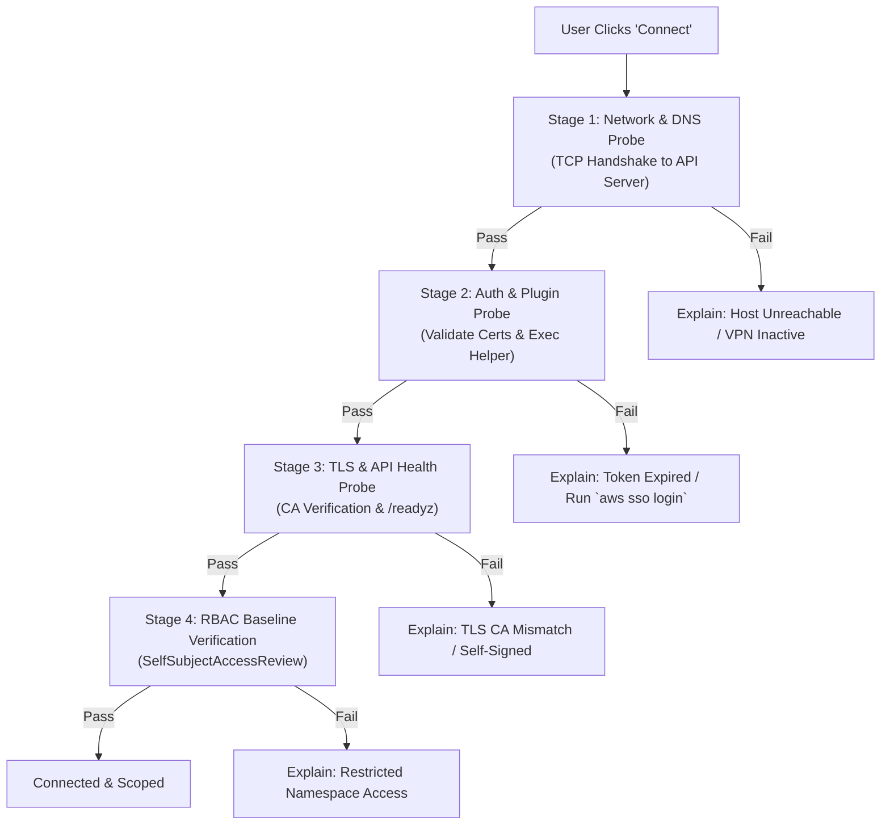

# Phase 2: Kubernetes Connection Management Specification

> **Phase Goal:** Deliver rock-solid, production-grade cluster connectivity. Run a dedicated **Go 1.23+ engine sidecar** with official **`k8s.io/client-go`** and **`clientcmd`**. Provide a 100% **agentless, local-first** connection model with automated 4-stage diagnostic checks.

---

## 1. Functional Scope

### 1.1 Agentless Kubeconfig Loading & Aggregation (Go `clientcmd`)
- Strictly agentless: Connects over HTTPS/TLS directly from the local workstation. No cluster-side agent, operator, or CRD installation required.
- Auto-detects standard kubeconfig locations via `k8s.io/client-go/tools/clientcmd`:
  - Custom file paths defined via `$KUBECONFIG` environment variable.
  - Standard user path: `~/.kube/config`.
  - Manual import via file picker or drag-and-drop.
- Robust merging of multiple kubeconfig files following official `kubectl` precedence rules.
- Support for clusters with self-signed CA certificates, custom proxies, and client cert/key authentication.

### 1.2 Context & Namespace Management
- Instant context switcher in the app header displaying:
  - Cluster name and alias.
  - API server URL.
  - Active namespace.
  - Connection status badge (Green = Connected, Yellow = Degraded/Slow, Red = Offline).
- Namespace switcher supporting:
  - Searchable list of all accessible namespaces.
  - "All Namespaces" aggregate mode.
  - Pinned/favorite namespaces for rapid switching.

### 1.3 Exec Credential Plugin Runner
Support modern cloud Kubernetes authentication without requiring manual token extraction:
- **AWS EKS:** `aws eks get-token` or `aws-iam-authenticator`.
- **Azure AKS:** `kubelogin` (Azure Active Directory / Entra ID).
- **Google Cloud GKE:** `gke-gcloud-auth-plugin`.
- **Custom OIDC Helpers:** Arbitrary exec plugins conforming to `client.authentication.k8s.io/v1`.
- Safe execution: Execute plugin binaries directly with sanitised arguments, preventing shell injection vulnerabilities.
- Token caching: Cache returned tokens according to their `expirationTimestamp` to prevent repeated subprocess spawning. Tokens stay in memory and are never exposed to the UI.

### 1.4 Dynamic Kubeconfig Watching & Hot Reload
- Utilize OS-level filesystem watchers (`fsnotify` in Go) to monitor loaded kubeconfig files.
- Automatically refresh cluster contexts when an external tool (e.g. `aws eks update-kubeconfig`, `kubectx`) alters the file.
- Silent reload: Avoid jarring UI resets or lost user view states during automatic reloads.

### 1.5 Automated 4-Stage Connection Diagnostics
When connecting or diagnosing connectivity failures, the engine runs 4 sequential probes:



---

## 2. Technical Implementation Architecture

### JSON-RPC Protocol Contract (`rpc/v1`)
```json
// Request: Connect & Probe Context
{
  "jsonrpc": "2.0",
  "id": "conn-01",
  "method": "clusters.connect",
  "params": {
    "contextName": "arn:aws:eks:us-east-1:123456789012:cluster/prod"
  }
}

// Response: Detailed Diagnostic Breakdown
{
  "jsonrpc": "2.0",
  "id": "conn-01",
  "result": {
    "status": "connected",
    "clusterName": "prod",
    "serverVersion": "v1.34.1",
    "latencyMs": 42,
    "stages": {
      "network": { "passed": true, "latencyMs": 12 },
      "authentication": { "passed": true, "authType": "exec", "user": "admin@company.com" },
      "tls": { "passed": true, "validUntil": "2027-01-01T00:00:00Z" },
      "rbac": { "clusterAdmin": false, "allowedNamespaces": ["default", "staging"] }
    }
  }
}
```

---

## 3. Acceptance Criteria & Quality Gates

1. **Zero-Touch Onboarding:** An engineer with a working `~/.kube/config` reaches an active cluster dashboard within 2 clicks.
2. **Context Switching Speed:** Switching between active clusters takes < 400ms to re-establish API connectivity.
3. **Exec Plugin Resilience:** Successfully refreshes tokens from AWS, Azure, and GCP CLI helpers without UI latency.
4. **Out-of-Band Update Detection:** Editing `~/.kube/config` externally updates the KubeView cluster list within 500ms.
5. **Clear Error Explanations:** When VPN is down or SSO token is expired, displays an actionable remedy card with exact terminal commands to resolve the issue.
