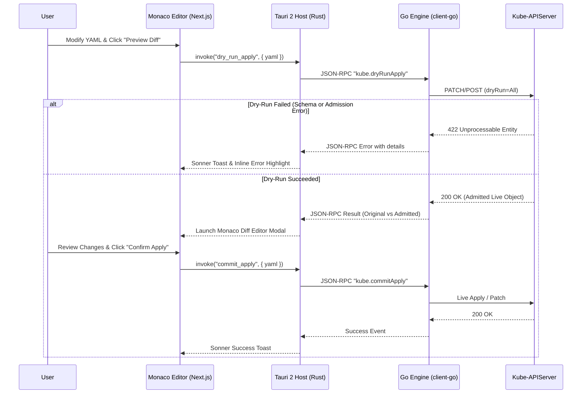

# Phase 5: Resource Operations & YAML Editor Specification

> **Phase Goal:** Equip engineers with an intelligent YAML editor powered by **Monaco Editor**, a Git-style visual diff using **Monaco Diff Editor**, forms managed with **React Hook Form + Zod**, and safe server-side dry-run mutation guardrails.

---

## 1. Functional Scope

### 1.1 Monaco YAML Editor with Kubernetes Schema Intelligence
- Integrated Monaco Editor specifically optimized for Kubernetes manifests.
- Injects Kubernetes JSONSchema dynamically corresponding to the target cluster's exact minor version.
- Real-time schema validation with inline red squigglies and descriptive hover tooltips.
- Intelligent auto-completion for `apiVersion`, `kind`, `spec` fields, and common container configurations.
- Form editing alternative powered by **React Hook Form** and **Zod** schema validation for quick parameter edits.

### 1.2 Better than Freelens: Server-Side Dry Run & Monaco Diff Editor
Before applying mutations to live clusters, KubeView provides an explicit verification step:
1. **Validation Dry-Run:** Performs a Server-Side Apply or Patch using the `dryRun=All` query parameter via the Go engine.
2. **Admission Preview:** Captures any mutations injected by admission webhooks (e.g. Istio sidecar injection, Kyverno/OPA mutations, default securityContexts).
3. **Monaco Diff Editor:** Shows a Git-style side-by-side or inline visual diff comparing the current live resource against the proposed admitted manifest.
4. **Destructive Modification Warning:** Flags changes that require resource recreation (immutable fields) or will trigger rolling pod termination.

### 1.3 Workload Lifecycle Operations
- **Scale Workloads:** Quick-scale modal with slider and numeric input for Deployments, StatefulSets, and ReplicaSets.
- **Rollout Restart:** Trigger zero-downtime rolling restart (`kubectl rollout restart`) by updating the `kubectl.kubernetes.io/restartedAt` annotation.
- **Rollout Pause & Resume:** Pause in-progress deployments and resume them when ready.
- **Rollout History & Undo:** Inspect revision numbers, change reasons, and roll back to previous revisions with 1 click.
- **CronJob Lifecycle:** Suspend, resume, and trigger immediate manual execution.

### 1.4 Safe Deletion & Guardrails
- Confirmation dialog displaying the resource name, namespace, and affected dependent resources.
- For critical namespaces (`kube-system`, `production`, etc.), require the user to explicitly type the resource name to confirm deletion.
- Background RBAC authorization pre-check (`SelfSubjectAccessReview`) to disable delete/edit buttons if the user lacks the required RBAC verb.

### 1.5 Utility Actions
- **Clean YAML Copy:** Copies manifest to clipboard with noisy metadata stripped (`managedFields`, `resourceVersion`, `uid`, `creationTimestamp`, `status`).
- **Copy kubectl Command:** One-click copy for equivalent CLI commands (e.g. `kubectl scale deployment my-app --replicas=3 -n default`).

---

## 2. Technical Implementation Architecture

---

## 3. Acceptance Criteria & Quality Gates

1. **Schema Validation:** Syntax errors and schema violations are highlighted inline within 100ms of typing.
2. **Zero Surprises:** Users can always preview the exact server-side diff in Monaco Diff Editor before any mutation commits to the cluster.
3. **Rollout Controls:** Rolling restart of a Deployment triggers immediately and visual progress is updated in real time.
4. **Clean Export:** Exported YAML contains no `managedFields` clutter and is immediately reusable with standard `kubectl apply -f`.
