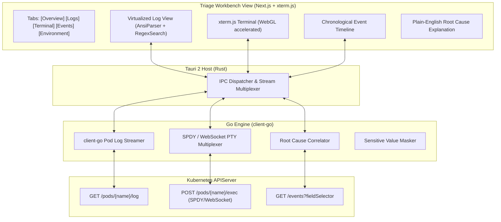

# Phase 6: Pod & Container Troubleshooting Workbench Specification

> **Core Differentiator:** A single-click troubleshooting workbench that unifies live logs, container terminal execution via **`xterm.js`**, chronological events, condition explanations, and probe diagnostics into a cohesive triage workspace.

---

## 1. Functional Scope

### 1.1 High-Performance Live Log Streamer
- Real-time log streaming from Kubernetes API via the Go engine through local IPC with zero UI lag.
- **Multi-Container Support:** Stream from a specific container or merge logs from all containers in a multi-container pod with color-coded container prefixes.
- **Previous Container Logs:** View logs from previous terminated or crashed container instances (`previous: true`) for debugging crash loops.
- **Search & Filtering:** Instant regex search, keyword filtering, case sensitivity toggles, and live match highlighting.
- **Stream Controls:** Pause stream, resume stream, toggle autoscroll (sticks to bottom unless user scrolls up), and clear viewport.
- **Time Ranges & Limits:** Support tail line counts (100, 500, 1000, 5000, all) and `date-fns` time filters (`--since=5m`, `15m`, `1h`, `24h`).
- **Exporting:** Download complete log file or copy selected lines directly to clipboard.

### 1.2 Container Exec Interactive Terminal (`xterm.js`)
- Built-in full terminal powered by `xterm.js` with WebGL addon for hardware acceleration.
- SPDY/WebSocket PTY multiplexing in Go engine supporting terminal resize events (`SIGWINCH`), colors, cursor control, and copy/paste shortcuts.
- Automatic shell detection: probes `/bin/bash`, fallback to `/bin/sh`, with support for custom binaries.
- Multi-session support: open multiple terminal sessions across different containers simultaneously.

### 1.3 One-Click Triage Workbench (Core Differentiator)
When an engineer encounters an unhealthy pod (e.g. `CrashLoopBackOff`, `OOMKilled`, `ImagePullBackOff`, `Pending`), a single click opens the **Troubleshooting Workbench**, which synthesizes:

1. **Failure State Summary:**
   - Last exit code (e.g. Exit Code `137` = Out Of Memory killed, `1` = Application Error).
   - Termination reason and timestamp.
   - Container restart count badge with historical restart timestamps.
2. **Plain-English Diagnostic Explanations:**
   - Detects `ImagePullBackOff` and checks image name, tag, and missing `imagePullSecrets`.
   - Detects `CrashLoopBackOff` and immediately surfaces the last 20 lines of the terminated container's logs.
   - Detects `Pending` and checks node scheduling constraints, taints/tolerations, affinity rules, and insufficient CPU/Memory.
3. **Probe Diagnostics:**
   - Analyzes Liveness, Readiness, and Startup probes.
   - Correlates probe failure events directly with container restarts.
4. **Chronological Event Feed:**
   - Filters cluster events specifically related to this pod and its parent workload over the last 2 hours.
5. **Environment & Secret Inspector:**
   - View container environment variables with sensitive Secrets and ConfigMaps masked by default.
   - Click-to-reveal with base64 decoding for authorized users.
6. **Parent & Related Navigation:**
   - Quick breadcrumbs to parent ReplicaSet, Deployment/StatefulSet, Node, and connected Service endpoints.

### 1.4 Troubleshooting Bundle Export
- One-click "Export Incident Bundle" button.
- Packages pod `kubectl describe` text, recent events, previous termination logs, and current live logs into a single downloadable `.zip` or markdown report for incident post-mortems.

---

## 2. Technical Implementation Architecture

---

## 3. Acceptance Criteria & Quality Gates

1. **High Log Throughput:** Handles log burst rates of 25,000 lines/second without browser freezing or memory leaks.
2. **Terminal Responsiveness:** Keystrokes appear instantly (<30ms round-trip latency to local/remote clusters).
3. **Automated Root Cause:** An `OOMKilled` pod automatically displays a highlighted badge: *"Container was terminated due to exceeding its memory limit (Exit Code 137). Current limit: 256Mi."*
4. **Export Completeness:** Exported troubleshooting bundle contains all logs, events, and YAML descriptors needed to debug an outage asynchronously.
